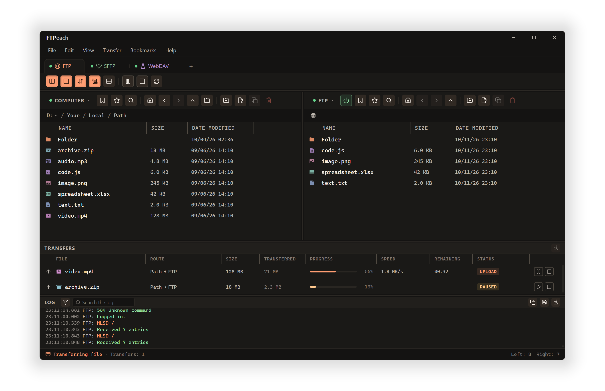
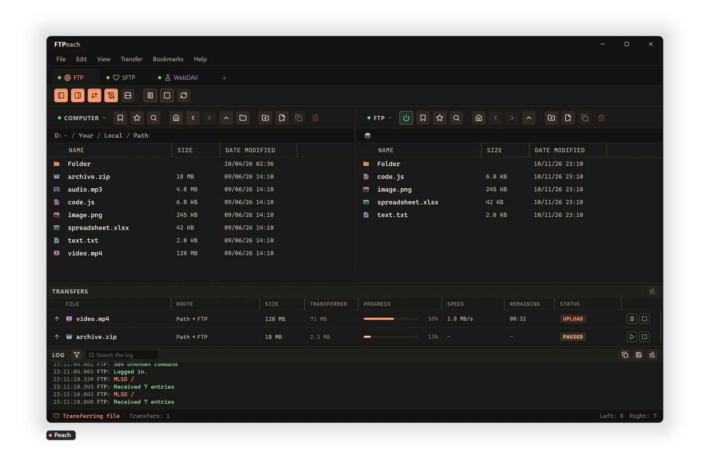

#  FTPeach

A desktop file transfer client for Windows.

Browse local and remote folders side by side, copy files between servers, and keep track of every transfer in one window. FTPeach supports **FTP, FTPS, SFTP, and WebDAV**, with tabs, saved connections, and an interface available in 27 languages.

**[Download for Windows](https://github.com/Smooveemaan/ftpeach/releases/latest)** · [Website](https://ftpeach.com/) · [Release notes](CHANGELOG.md) · [Documentation](docs/README.md) · [Report a bug](https://github.com/Smooveemaan/ftpeach/issues)

> **Made with AI. Use at your own risk!** 
> I made FTPeach with a lot of help from AI, and the project is in pre-release. 
> I’ve tested it carefully, but please back up files that matter to you.

<picture>
  <source media="(prefers-color-scheme: dark)" srcset="assets/images/ftpeach-dark.png">
  <source media="(prefers-color-scheme: light)" srcset="assets/images/ftpeach-light.png">
  
</picture>

Support FTPeach:&emsp;<a href="https://ko-fi.com/smooveemaan"><picture><source media="(prefers-color-scheme: dark)" srcset="assets/images/kofi-dark.png"></picture></a>&emsp;<a href="https://www.patreon.com/Smooveemaan"><picture><source media="(prefers-color-scheme: dark)" srcset="assets/images/patreon-dark.png"></picture></a>

## Get started

FTPeach supports **Windows 10 and 11, x64**. Versions for macOS and Linux are coming soon.

1. Download the installer from the [latest release](https://github.com/Smooveemaan/ftpeach/releases/latest) and run it.
2. Open FTPeach and enter your server's connection details.
3. Browse your folders and drag files to the destination pane. Follow their progress in the transfer queue.

You can save connections for your next session. With automatic updates enabled, FTPeach checks for updates at startup and daily, downloads them in the background, and installs them on the next launch or when you choose to restart. Update signatures are verified before installation.

To run FTPeach without installing it, download `FTPeach_<version>_x64-portable.zip` from the same page, unpack it and start `FTPeach.exe`. Settings, bookmarks, and saved passwords stay in the `data` folder beside the program, so moving the folder moves everything. Set a master password in Settings if saved passwords should work on another computer. What a portable copy leaves on a computer is listed under [portable mode](docs/storage.md#portable-mode).

## Made for everyday file transfers

- **Work side by side.** Two independent file panes with tabs, search, and sorting help you find and organize files.
- **Move files where you need them.** Upload, download, or copy between servers through FTPeach, with drag and drop for everyday operations.
- **Stay in control.** Run concurrent transfers, pause or cancel transfers, and set speed limits from the transfer queue.
- **Use your own editor.** Open remote files in an external application and upload your changes back to the server.
- **Make it comfortable.** Choose from 20 color schemes in light or dark mode, and use the interface in any of 27 languages.
- **Keep connections handy.** Save server details, protect stored passwords, and optionally add a master password.

## Color schemes

Make FTPeach your own with 20 color schemes, from warm Peach and leafy greens to cool blues and neutral grays. Every scheme supports light and dark mode; Peach is the default. Choose yours in **Settings > Interface**.

<picture>
  <source media="(prefers-color-scheme: dark)" srcset="assets/images/ftpeach-palettes-dark.webp">
  <source media="(prefers-color-scheme: light)" srcset="assets/images/ftpeach-palettes-light.webp">
  
</picture>

[Try the color schemes on the website](https://ftpeach.com/#themes).

## Protocols and compatibility

| Protocol | Connection security | Resume downloads | Resume uploads |
| --- | --- | --- | --- |
| FTP | Unencrypted | Yes | Yes |
| FTPS | Explicit TLS | Yes | Yes |
| SFTP | SSH | Yes | Yes |
| WebDAV | TLS when using HTTPS | Yes | No |

Server-to-server copying is relayed through your computer. Available operations also depend on the server's capabilities and your permissions.

FTPS uses explicit TLS (`AUTH TLS`); implicit FTPS is not supported. WebDAV uploads are streamed, but interrupted uploads must restart from the beginning. WebDAV downloads resume when the server supports range requests and safely restart otherwise.

For WebDAV, enter a full `https://` URL, including the server's WebDAV path. Signing in over unencrypted HTTP requires an explicit opt-in for that connection.

See [protocol support](docs/protocol-support.md) for the full compatibility matrix, or [networking](docs/networking.md) for proxy and connection settings.

## Passwords and server verification

Saved passwords and SSH-key passphrases follow the protection mode selected in settings:

- **System protection** (default) encrypts secrets for your Windows account, without a master password. Anyone acting as that Windows user can access them.
- **Enhanced protection** stores secrets in a vault encrypted with a master password. You can optionally enable Windows Hello to unlock it on this computer.

Keep the master password safe: it cannot be recovered, and it remains the recovery method if Windows Hello becomes unavailable.

For SFTP, the default settings require you to confirm the server's host key before the first connection can authenticate. Verify the displayed fingerprint with your server administrator before trusting it. FTPeach remembers the approved key and blocks subsequent connections if it changes, pending a new confirmation.

For implementation details, see the [security design](docs/security.md). To report a vulnerability privately, follow the [security policy](.github/SECURITY.md).

## Explore the project

| If you want to… | Start here |
| --- | --- |
| Connect, transfer and edit files, or solve a common problem | [User guide](docs/guide/index.md) |
| Build from source | [Development setup](docs/development.md) |
| Understand the code structure | [Architecture](docs/architecture.md) and [frontend architecture](docs/frontend-architecture.md) |
| Understand connections and transfers | [Protocol support](docs/protocol-support.md), [networking](docs/networking.md), and [transfer safety](docs/transfer-safety.md) |
| Learn how settings and credentials are handled | [Storage](docs/storage.md) and [security design](docs/security.md) |
| Investigate performance | [Frontend measurements and benchmarks](docs/frontend-performance.md) |
| Work on releases | [Updater signing](docs/updater-signing.md) and [dependency policy](docs/dependency-policy.md) |

The [documentation index](docs/README.md) includes validation reports, IPC permissions, and the workspace layout.

## Help and contributions

Found a bug, have an idea, or want to report a translation problem? [Open an issue](https://github.com/Smooveemaan/ftpeach/issues). For bug reports, include your FTPeach version, Windows version, protocol, and steps to reproduce the problem. Remove passwords and private connection details from logs and screenshots before sharing them.

FTPeach does not accept pull requests: part of the tests a change has to pass are closed, so a pull request could not be checked here. See [CONTRIBUTING.md](.github/CONTRIBUTING.md).

## License

FTPeach is distributed under the [Apache License 2.0](LICENSE). See [third-party notices](docs/legal/THIRD_PARTY_NOTICES.txt) for dependency and asset acknowledgments.

Copyright © 2026 Leonid Lozovskii (Smooveemaan).
