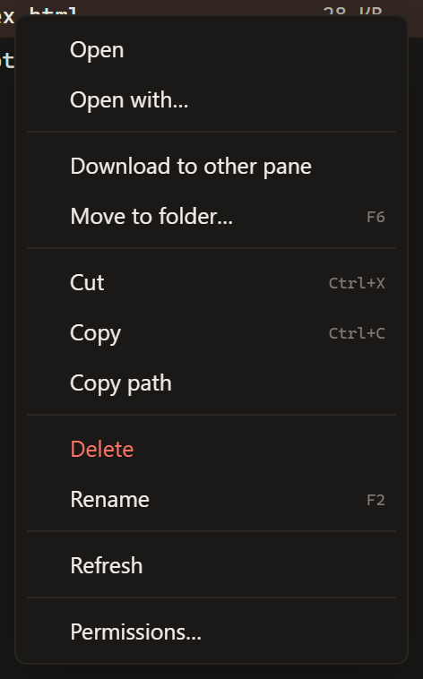
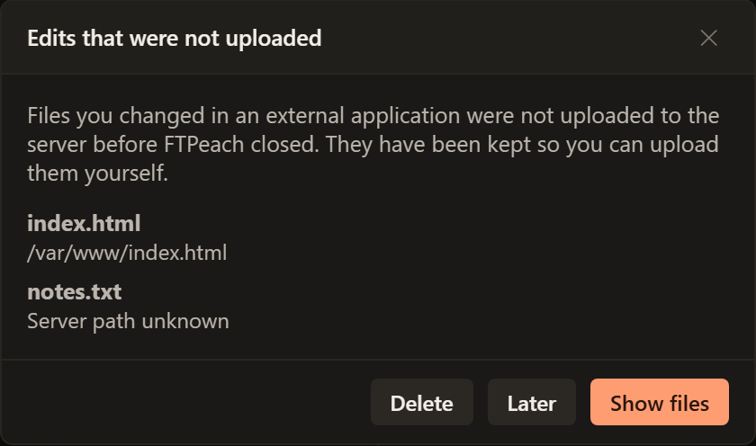

# Editing remote files

Use this workflow to change a text file or configuration on a server with a
program installed on your computer. FTPeach downloads an **edit copy**, a file
on your computer that it watches for changes while the connection stays open;
saving in the editor and sending that revision to the server are separate steps.

<!-- verified-by: pr test/component/open-with/openWithDialog.test.tsx::download ignores other jobs, clamps progress and registers a completed editable copy -->
<!-- verified-by: pr test/component/open-with/openWithRecovery.test.tsx::only an uploaded revision is marked synced, and a failed upload asks again -->

## Open, edit and upload a change

Before editing an important file, download a backup to a separate local folder.
Check that you have permission to replace the server copy.

1. Connect to the server and locate the file.
2. Right-click it and choose **Open** to use its usual program, or **Open with**
   to choose another program.
3. Make the change and save it in the editor.
4. Return to FTPeach. When it asks whether to upload the changed file, choose
   **Upload** to send that revision to the server. **Later** dismisses this
   question without uploading; do not treat a local save as a completed server update.
5. Check the upload result and, where appropriate, check the file in the system
   that uses it, such as the website or application you are updating.

Use **Open** for the usual application, or **Open with** to choose a program.

<!-- verified-by: pr test/component/file-browser/paneActions.test.ts::Open on a remote file opens it with the default program, without asking -->
<!-- verified-by: pr test/component/file-browser/paneActions.test.ts::SFTP permissions and open-with retain the entry and its original session -->
<!-- verified-by: pr test/component/open-with/openWithRecovery.test.tsx::changes to several copies are all asked about, one at a time -->
<!-- verified-by: pr test/component/open-with/openWithRecovery.test.tsx::only an uploaded revision is marked synced, and a failed upload asks again -->

After **Later**, FTPeach asks again when you change and save the edit copy.
If you want to send the existing revision without changing it, keep a copy in
a folder you can find, open that folder in the **Computer** pane and
[upload the file](getting-started.md#3-upload-the-file) to its original server
folder. Check the filename and destination before approving replacement.

<!-- verified-by: pr test/component/open-with/openWithRecovery.test.tsx::Later dismisses this revision and the next changed save asks again -->
<!-- verified-by: pr test/component/file-browser/paneActions.test.ts::a folder, and a whole selection, can be sent to the other pane from the menu -->

If you save again while an upload is running, FTPeach asks about the newer save
after that upload finishes. Keep track of the last revision you approved.

<!-- verified-by: pr test/component/open-with/openWithRecovery.test.tsx::a save made while an upload runs is asked about after it, not during -->

## Recover unfinished edits

If FTPeach offers recovered edits at startup, inspect them before deleting them.
Keep a separate copy of work you still need, reconnect to the intended server
and check its current file before replacing it. Recovery preserves your local
work; it does not mean that those changes already reached the server.

1. Choose **Show files** and find the edit copy you need. Open it to check its
   contents, then copy it to a separate local folder you can find again.
2. In FTPeach, open that folder in a **Computer** pane. In the other pane,
   connect to the original server and open the original file's folder.
3. Check the server file before replacing it: someone else may have changed it
   since your edit. Download a separate backup if you need to keep that version.
4. Select your saved edit copy and choose **Upload to other pane**.
   Use the original filename; if your backup copy has a different name, rename
   it before uploading. Follow [Your first transfer](getting-started.md#3-upload-the-file)
   for the upload steps.
5. Wait for **Done** in **Transfers** and check the server result. Keep your
   separate copy until you are satisfied. Only then discard the recovered
   copy you no longer need.

If you cannot identify the original server or folder, keep the copy and confirm
the destination before uploading. **Show files** does not send anything to the
server, and **Delete** discards the recovered work.

<!-- verified-by: pr test/component/open-with/openWithRecovery.test.tsx::recovered edits are offered at start and stay unless deleted -->
<!-- verified-by: pr test/component/file-browser/paneActions.test.ts::a folder, and a whole selection, can be sent to the other pane from the menu -->
<!-- verified-by: pr test/component/transfers/transferQueue.test.tsx::queue order puts running and paused rows first, newest within each status, and completed rows last -->

## Editing server files in another program

Opening a server file again while its copy is open, from any tab connected to the
same server and in any program, opens that same copy instead of downloading a
second one, so two copies never overwrite each other's changes. Once the
connection that opened it closes, the next open downloads the file again.

<!-- verified-by: pr src-tauri/src/local_fs/open_with.rs::a_file_opened_again_reuses_its_watched_copy_until_the_watch_stops -->
<!-- verified-by: pr src-tauri/src/commands/open_with.rs::a_launched_copy_can_be_launched_again_from_its_recorded_path -->

Copies you did not change are removed when the editing session is cleaned up.
Changed copies are kept, including after an unexpected exit; use
[Recover unfinished edits](#recover-unfinished-edits) to inspect them.

<!-- verified-by: pr src-tauri/src/local_fs/edit_recovery.rs::edited_copies_are_kept_and_untouched_ones_removed -->
<!-- verified-by: pr src-tauri/src/local_fs/edit_recovery.rs::a_crashed_session_is_collected_at_the_next_start -->
<!-- verified-by: pr test/component/open-with/openWithRecovery.test.tsx::recovered edits are offered at start and stay unless deleted -->
