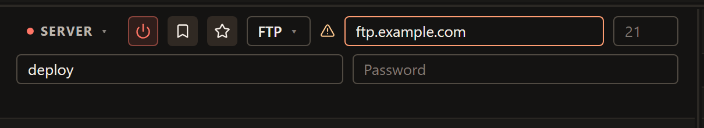
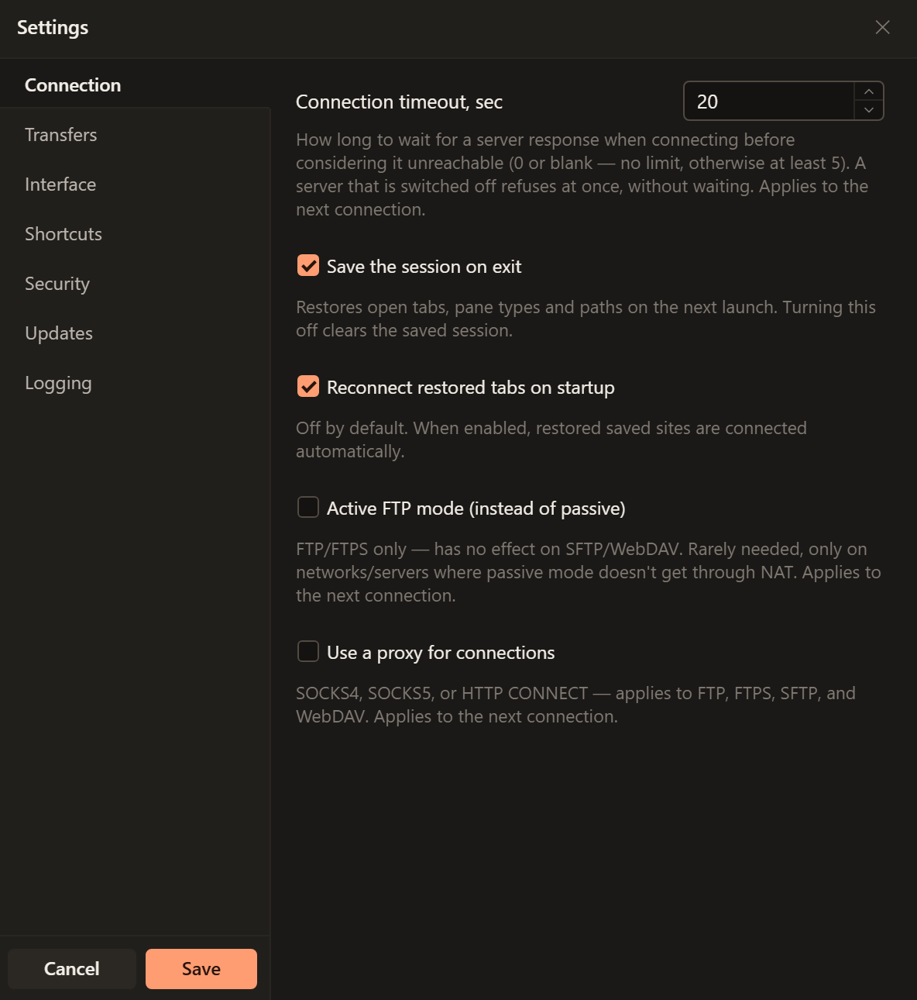

# FTP connections

Use FTP only when your provider requires an unencrypted connection. Plain FTP
sends your username, password and file contents without encryption. FTPeach
shows a warning beside the protocol selector. If the server offers an encrypted
option, use [FTPS](ftps.md) or [SFTP](sftp.md) with the details your provider supplies.

<!-- verified-by: pr test/component/file-browser/connectionBar.test.tsx::plain FTP carries the unencrypted warning, and an encrypted protocol drops it -->

## Connect to an FTP server

Get the FTP hostname, port, username, password and destination folder from your
provider. The address of your public website may not be its FTP hostname.

1. Open the source menu at the top of a pane and choose **Server**.
2. Choose **FTP**. Enter the server hostname in **Address**, then its **Port**.
   Use the provider's port rather than guessing from a website URL.
3. Enter **Username** and **Password**, then select **Connect**.
4. When the folder listing appears, open the folder your provider named. Try a
   small file with [Your first transfer](getting-started.md) before a large upload.

The warning marks plain FTP.

<!-- verified-by: pr test/component/file-browser/paneSourceSwitcher.test.tsx::the source selector opens a server form and returns to the computer -->
<!-- verified-by: pr test/component/file-browser/connectionBar.test.tsx::blank addresses disable connecting and saving until filled -->
<!-- verified-by: pr src-tauri/src/protocol/ftp_tests.rs::local_server_supports_connect_list_disconnect_and_reconnect -->

To reuse the connection, [save a bookmark](connecting.md#save-a-connection-you-will-use-again).

## Passive and active mode

FTP uses a connection for commands and separate connections for folder listings
and file contents. This is why a successful login does not always mean files can
be listed or transferred. These modes apply to both FTP and FTPS.

| Mode | Who opens the data connection? | What to check when it fails |
| --- | --- | --- |
| Passive | Your computer connects to a port offered by the server. | Ask the administrator whether the server's passive ports are reachable through its firewall and router. |
| Active | The server connects back to your computer. | The server must be able to reach your computer through its firewall and router. Use only when your administrator has arranged this. |

<!-- verified-by: pr src-tauri/src/protocol/ftp_tests.rs::local_server_supports_connect_list_disconnect_and_reconnect -->
<!-- verified-by: pr src-tauri/src/protocol/ftp_tests.rs::active_mode_stores_lists_and_fetches_over_the_servers_connection -->

Start with passive mode. In **Edit > Settings > Connection**, leave **Active FTP
mode (instead of passive)** unchecked. If the administrator specifically asks
for active mode, enable it, choose **Save**, then reconnect. Changing the setting
does not switch an existing connection.

An unchecked **Active FTP mode** means passive mode. The setting is unavailable
while a proxy is enabled; keep passive mode for proxy connections.

<!-- verified-by: pr test/component/settings/settingsDialog.test.tsx::active FTP mode is saved for connections and disabled with a proxy -->
<!-- verified-by: pr test/unit/file-browser/paneSessionLifecycle.test.ts::a typed-in FTPS server is sent as it is, and becomes connected only after its first listing -->

Active mode is not a general cure for a blocked transfer: it needs an incoming
connection to your computer. See the [networking reference](../networking.md#ftp-passive-and-active-modes)
for deployment details.

## When FTP does not connect or list files

| Message or symptom | Next step |
| --- | --- |
| Incorrect username or password. | Confirm the FTP account and whether the provider actually requires FTPS or SFTP. |
| The server refused the connection. Check the address and port. | Check the FTP hostname and port and ask whether the service is running. |
| The server isn't responding. Check the address, port and network. | Check server availability, VPN requirements and network access. |
| Login appears to work, but the listing or transfer stalls | Check the data-connection mode above and ask the administrator to check the relevant firewall and router ports. |
| The server couldn't connect back in active FTP mode. Try passive mode. | Turn active mode off, save and reconnect, unless your administrator requires and can configure active mode. |
| You don't have permission for this operation. | Confirm the destination folder and the account's permissions. A successful login does not grant access to every folder. |

<!-- verified-by: pr test/unit/platform/errorMessages.test.ts::friendlyError localizes every structured command error code -->
<!-- verified-by: pr src-tauri/src/protocol/ftp_tests.rs::a_refused_port_is_told_apart_from_an_unknown_listing_command -->

For a failed file operation, follow [transfer troubleshooting](troubleshooting.md#my-transfer-did-not-finish).
Use the [log when asking for help](troubleshooting.md#ask-for-help), removing private details before sharing it.
