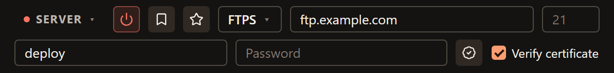

# FTPS connections

FTPS is FTP protected by TLS. Choose it when your provider offers **explicit
FTPS**, also called FTP with explicit TLS. It is different from [SFTP](sftp.md),
which uses SSH and a server host key instead of a TLS certificate.

FTPeach supports explicit FTPS, but **does not support implicit FTPS**. If your
provider specifies implicit FTPS, ask for an explicit FTPS endpoint or another
supported protocol. Changing a port number alone does not change the server's mode.

<!-- verified-by: pr src-tauri/src/protocol/ftp_tests.rs::local_ftps_server_rejects_bad_certificate_unless_explicitly_allowed -->
<!-- verified-by: pr src-tauri/src/protocol/ftp_tests.rs::implicit_ftps_is_rejected_as_a_tls_negotiation_error -->

## Connect with explicit FTPS

Ask your provider for the FTPS hostname, port, username, password and destination
folder. If the service uses a private certificate authority, ask for its CA
certificate too.

1. Open the source menu at the top of a pane and choose **Server**.
2. Choose **FTPS**, then enter **Address**. Use the hostname your provider gave
   you for the certificate, rather than substituting a different name.
3. The suggested **Port** is **21**. Enter another port if the provider specifies it.
4. Fill in **Username** and **Password**. Leave **Verify certificate** checked.
5. Select **Connect**. Once the folder listing loads, open your destination folder.

The badge-shaped button beside the password field selects a **CA certificate**.
Most public services do not require you to choose a separate file.

<!-- verified-by: pr test/component/file-browser/paneSourceSwitcher.test.tsx::the source selector opens a server form and returns to the computer -->
<!-- verified-by: pr test/component/file-browser/connectionBar.test.tsx::FTPS defaults to port 21 and keeps a custom CA behind certificate verification -->
<!-- verified-by: pr test/unit/file-browser/paneSessionLifecycle.test.ts::a typed-in FTPS server is sent as it is, and becomes connected only after its first listing -->

## Verify the certificate

With **Verify certificate** enabled, FTPeach rejects a certificate it cannot
validate. Treat the error as a reason to check the hostname and certificate
with the provider, rather than immediately disabling verification.

<!-- verified-by: pr src-tauri/src/protocol/ftp_tests.rs::local_ftps_server_rejects_bad_certificate_unless_explicitly_allowed -->

For a private certificate authority:

1. Get the CA certificate in PEM format from the administrator.
   This is a certificate, not a private key or an account password.
2. Keep **Verify certificate** enabled and select **CA certificate** in the
   connection form. Choose the file you received.
3. Connect again. If verification still fails, ask the administrator to check
   the certificate chain, hostname and validity dates.

<!-- verified-by: pr test/component/file-browser/connectionBar.test.tsx::FTPS defaults to port 21 and keeps a custom CA behind certificate verification -->
<!-- verified-by: pr src-tauri/src/protocol/ftp_tests.rs::local_ftps_server_accepts_a_matching_custom_ca_and_rejects_a_mismatched_one -->

Unchecking **Verify certificate** allows invalid certificates and disables the
CA-file button. The connection still uses TLS, but that is no substitute for
checking the server's identity.

<!-- verified-by: pr test/component/file-browser/connectionBar.test.tsx::FTPS defaults to port 21 and keeps a custom CA behind certificate verification -->
<!-- verified-by: pr src-tauri/src/protocol/ftp_tests.rs::an_unchecked_ftps_certificate_is_warned_about_once_and_only_over_tls -->

## When FTPS does not connect

| Message or symptom | What to check |
| --- | --- |
| The server's certificate isn't valid. | Check the hostname and certificate with the provider. For a private CA, use the trusted CA file as described above. |
| Couldn't set up encryption (TLS) with the server. | Confirm that the endpoint supports explicit FTPS and that you used its correct port. An implicit-only service is unsupported. |
| Incorrect username or password. | Confirm the account details and that the account is allowed to use this service. |
| The key or certificate file was not found | Select the CA certificate again if it has moved or its drive is unavailable. |
| Sign-in works, but files do not list or transfer | FTPS also uses FTP data connections. Check [passive and active mode](ftp.md#passive-and-active-mode) with the administrator. |

<!-- verified-by: pr test/unit/platform/errorMessages.test.ts::friendlyError localizes every structured command error code -->
<!-- verified-by: pr src-tauri/src/protocol/ftp_tests.rs::implicit_ftps_is_rejected_as_a_tls_negotiation_error -->

Do not switch to plain FTP to dismiss a TLS error: that changes the connection's
protection. Confirm the correct service with your provider instead.

Once connected, try [a small first transfer](getting-started.md), then
[save a bookmark](connecting.md#save-a-connection-you-will-use-again) for next time.
For interrupted jobs, see [Transfers and files](transfers.md).
