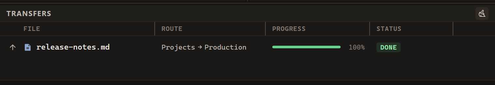

# Your first transfer

This walkthrough uploads one file from your computer to a server, then explains
how to download a file in the other direction. For a first attempt, use a small,
non-sensitive file with a new name so there is no existing file to replace.

## Before you begin

Download FTPeach from the [official website](https://ftpeach.com/). Choose the
installer for a regular installation, or read [Portable version](portable.md)
if you want to keep the application and its settings together in a folder.

<!-- verified-by: pr test/unit/tooling/siteBuild.test.ts::a release with a portable copy offers both downloads -->

Have these details ready. Your hosting provider or server administrator supplies
them; FTPeach cannot determine your account password or destination folder.

| Detail | What to ask for |
| --- | --- |
| Protocol | FTP, FTPS, SFTP or WebDAV |
| Address and port | The server hostname and port, or the full WebDAV URL |
| Account | Username and password, or the SSH key required for SFTP |
| Destination | The folder where your account is allowed to upload |
| Server identity | For SFTP, the expected host key fingerprint |

## 1. Connect to the server

Keep one pane on **Computer**. At the top of the other pane, click the source
button and choose **Server** to open the connection form. You can use that same
menu to switch a pane back to **Computer**.

<!-- verified-by: pr test/component/file-browser/paneSourceSwitcher.test.tsx::the source selector opens a server form and returns to the computer -->

In the connection form, choose the protocol you were given and enter the **Address**,
**Port**, **Username** and **Password** your server uses. Select **Connect**, the
power-symbol button next to **Server**.

<!-- verified-by: pr test/component/file-browser/connectionBar.test.tsx::blank addresses disable connecting and saving until filled -->

For SFTP, compare the first host key prompt with the fingerprint supplied by the
administrator before trusting it. If it differs, stop and check with them.
See [Connecting safely](connecting.md#connecting-safely).

<!-- verified-by: pr src-tauri/src/protocol/sftp_tests.rs::local_server_pins_reuses_and_rejects_changed_host_key -->

A successful connection displays the server's folder listing. If that does not
happen, use [Troubleshooting](troubleshooting.md#i-cannot-connect) before trying
to transfer a file.

<!-- verified-by: pr test/unit/file-browser/paneSessionLifecycle.test.ts::a typed-in FTPS server is sent as it is, and becomes connected only after its first listing -->

## 2. Open the source and destination folders

In the computer pane, find your test file. In the server pane, open the folder
your provider told you to use. Double-click a folder to open it. Check the
destination path before you go on: connecting to the right server is not the
same as choosing the right folder on it.

<!-- verified-by: pr test/component/file-browser/paneWiring.test.tsx::a folder opens in the pane and a server file opens with its program -->

## 3. Upload the file

Select the file in the computer pane, right-click it and choose **Upload to other
pane**. You can also drag the selection to the server pane. Dropping on the
listing's background uses the currently open destination folder.

<!-- verified-by: pr test/component/file-browser/paneActions.test.ts::the menus follow the order of the Explorer menu -->
<!-- verified-by: pr test/component/file-browser/filePane.test.tsx::starts a pane-to-pane drag with the current multi-selection -->
<!-- verified-by: pr test/component/file-browser/paneWiring.test.tsx::a drop on the listing itself has no target folder -->

If asked about an existing file, check its name and destination before allowing
replacement.

## 4. Check the result

Look in **Transfers** for the file and its **Route**. Wait for **Done**;
**Upload** and **Queued** are not completed transfers. If it failed, read the
error and follow [Troubleshooting](troubleshooting.md).

Some columns are hidden in this example.

<!-- verified-by: pr test/component/transfers/transferQueue.test.tsx::direction arrow is pinned before Route and File, while Status stays sortable -->
<!-- verified-by: pr test/component/transfers/transferQueue.test.tsx::queue order puts running and paused rows first, newest within each status, and completed rows last -->

Look for the file in the server pane. To be sure it arrived as you meant, download
it to another folder on your computer and open it.

## Download a file instead

Open the destination folder in the computer pane. Select a file in the server
pane, right-click and choose **Download to other pane**. Check the route and
result just as you did for the upload.

<!-- verified-by: pr test/component/file-browser/paneActions.test.ts::the menus follow the order of the Explorer menu -->

Next, [save a bookmark](connecting.md#save-a-connection-you-will-use-again), learn
how to [select several files](interface.md), or [edit a remote file](editing.md).
