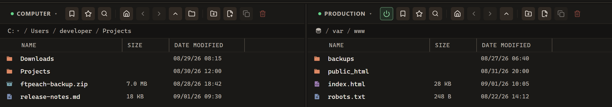

# User guide

FTPeach is a file transfer client for Windows. Use it to put files on a server,
bring files back to your computer, or copy them between servers. For example,
you might upload a website, collect documents from a shared server, or download
a copy before editing it.

<!-- verified-by: pr test/component/transfers/useTransfers.test.tsx::folder upload, download and relay submit endpoint intent without per-file IPC -->

You need access to a server: its address, connection type and account details.
Ask your hosting provider or server administrator for these. Installing a client
does not create a server or a hosting account.

**New here? Start with [Your first transfer](getting-started.md).** It takes you
from connection details to checking that a small file reached its destination.

Two locations side by side: choose where a file comes from and where it should go.
The illustrations throughout this guide use example connections and files.

## Find the task you want to do

| I want to… | Read |
| --- | --- |
| Connect and send my first file | [Your first transfer](getting-started.md) |
| Understand the panes, find files and select them | [Find your way around](interface.md) |
| Choose a protocol or save a connection | [Connect to a server](connecting.md) |
| Connect with SFTP or an SSH key | [SFTP connections](sftp.md) |
| Connect with FTP or understand passive mode | [FTP connections](ftp.md) |
| Connect with FTPS and check certificates | [FTPS connections](ftps.md) |
| Connect to a WebDAV folder over HTTPS | [WebDAV connections](webdav.md) |
| Upload, download, copy, pause or retry | [Transfers and files](transfers.md) |
| Change a server file in my editor | [Editing remote files](editing.md) |
| Move bookmarks and saved passwords to another computer | [Passwords and bookmarks](passwords.md) |
| Carry FTPeach on a removable drive | [Portable version](portable.md) |
| Understand an error or recover unfinished work | [Troubleshooting](troubleshooting.md) |

## Words used in this guide

**Local** means on your computer; **remote** means on a server. An **upload**
copies a local file to a server. A **download** copies a server file to your
computer. The **source** is where the file comes from; the **destination** is
where the copy goes. Check both before starting a transfer.

FTPeach shows two file lists, called **panes**. Either can be the source or the
destination. A **bookmark** saves the connection details so you can open a
server again without typing them each time.

<!-- verified-by: pr test/component/file-browser/paneActions.test.ts::the menus follow the order of the Explorer menu -->
<!-- verified-by: pr test/component/sites/siteManager.test.tsx::creates and edits a bookmark through the form -->
<!-- verified-by: pr test/component/sites/siteManager.test.tsx::clicking a site row connects; clicking its own buttons does not -->

The **protocol** is the kind of connection your server accepts: FTP, FTPS, SFTP
or WebDAV. Use the one supplied by your provider; they are not interchangeable.
See [connection details](connecting.md) for help choosing the right fields.

For version changes, see the [changelog](../../CHANGELOG.md). For detailed
compatibility and limitations, see the [protocol reference](../protocol-support.md).
