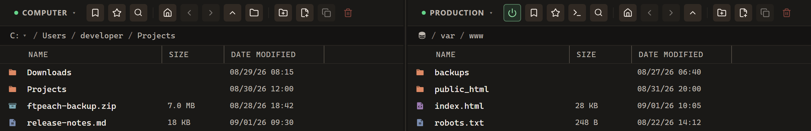
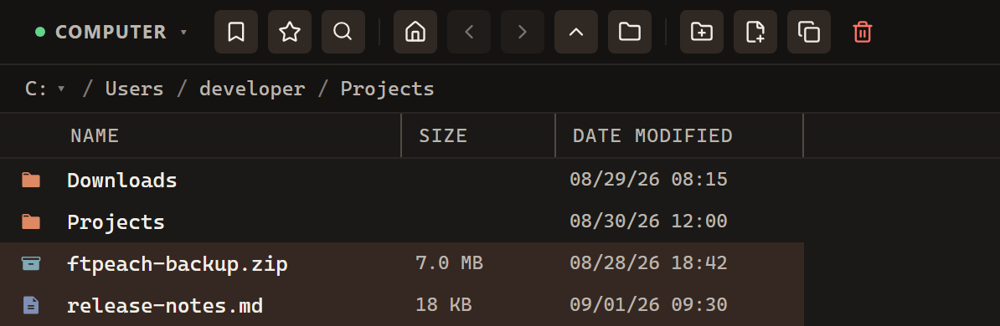
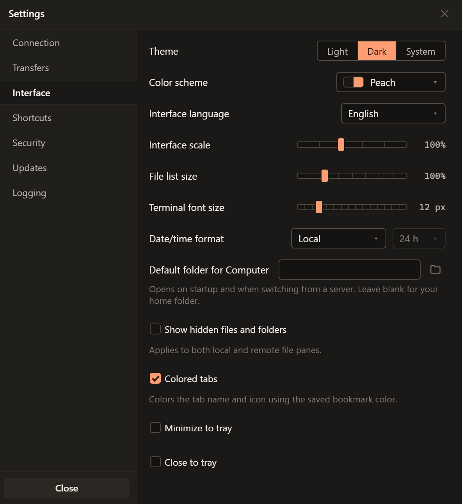

# Find your way around

The window has two file panes, with **Transfers** below them. "Other pane" in a
command means the folder open on the opposite side, not a fixed upload or
download folder.

<!-- verified-by: pr test/component/file-browser/paneActions.test.ts::the menus follow the order of the Explorer menu -->

## Work with tabs

Use **File > New Tab** or `Ctrl+T` / `⌘T` to open another workspace.
`Ctrl+Tab` / `⌃Tab` switches to the next tab; `Ctrl+Shift+Tab` / `⌃⇧Tab` goes to
the previous one. Use **File > Close Tab** or `Ctrl+W` / `⌘W` to close the
current tab, and `Ctrl+Shift+T` / `⇧⌘T` to reopen the most recently closed tab.
The last remaining tab stays open; on macOS, `⌘W` hides the window when only one
tab is open. Check running transfers before closing a server connection.

<!-- verified-by: pr test/component/application/applicationCommands.test.tsx::tab shortcuts open, close, reopen and cycle tabs -->
<!-- verified-by: pr test/component/application/applicationCommands.test.tsx::the last tab is not closed and a single tab does not cycle -->
<!-- verified-by: pr test/unit/application/menus.test.ts::menu commands bind current tab, pane and theme and both copy refresh callbacks -->

## Open folders and find files

Read each pane from top to bottom: connection or computer, open folder, then files.

Double-click a folder to open it, or press `Enter` / `⌘↓`. `Backspace` / `⌘↑`
goes up one directory level. Click a column heading to sort the listing. The
file filter helps narrow the current list; use it after opening the folder you
want to search.

<!-- verified-by: pr test/component/file-browser/paneWiring.test.tsx::a folder opens in the pane and a server file opens with its program -->
<!-- verified-by: pr test/component/file-browser/filePane.test.tsx::Backspace navigates the pane up one directory level -->
<!-- verified-by: pr test/component/file-browser/filePane.test.tsx::selects, sorts, filters and supports keyboard actions -->

## Selecting files

In a **Computer** pane, right-click a file or folder and choose **Show in File Explorer**
(Windows), **Show in Finder** (macOS), or **Open containing folder** (Linux),
next to **Open**, to show it in the system file manager. On Windows and macOS
this selects the item directly. On Linux, FTPeach highlights it if your file
manager (such as Nautilus or Dolphin) supports it, or opens the parent folder
instead. The command uses only the entry you right-clicked, even when several
entries are selected. Server panes do not have this command.

<!-- verified-by: pr test/component/file-browser/paneActions.test.ts::Reveal location targets only the clicked local file or folder -->

Click a file to select it. `Ctrl+click` / `⌘+click` adds or removes individual
files from the selection; `Ctrl+A` / `⌘A` selects the list. Right-click a file
for the actions available there, or right-click empty space for folder actions
such as **Refresh** and **New Folder**.

Highlighted rows are the selection.

<!-- verified-by: pr test/component/file-browser/filePane.test.tsx::Ctrl+click toggles against the current selection, not the one from before the last re-render -->
<!-- verified-by: pr test/component/file-browser/filePane.test.tsx::Ctrl+A selects every file even while a descendant control (not .pane itself) has focus -->
<!-- verified-by: pr test/component/file-browser/paneActions.test.ts::the menus follow the order of the Explorer menu -->

You can also drag a selection rectangle inside the file list. It stays within
that pane when the pointer crosses into the neighbouring pane.

<!-- verified-by: manual Selection rectangle with system animations disabled -->

When a folder's list is refreshed, with `F5` / `⌘R` or because a transfer
finished there, the files still in it stay selected, and the arrow keys and
`Shift` carry on from the same file. Files you select while the list is still
loading are the ones that stay selected. On Linux, visible local folders also
refresh automatically when files are moved or changed outside FTPeach.

<!-- verified-by: pr test/component/file-browser/paneRefresh.test.tsx::a transfer refresh leaves a pane the user browsed away from, and keeps the selection -->
<!-- verified-by: pr test/component/file-browser/paneRefresh.test.tsx::a selection made while the folder is listed again is the one kept -->
<!-- verified-by: pr test/component/file-browser/filePane.test.tsx::the folder listed again keeps the keyboard cursor; another folder starts from the top -->

## Follow work in Transfers

The **Transfers** list identifies the file, route and status of a job. Check the
route when several servers are open. Running and paused jobs appear before
completed ones, and a job keeps naming its server even after that connection
closes. See [Transfers and files](transfers.md) for pausing and recovery.

<!-- verified-by: pr test/component/transfers/transferQueue.test.tsx::direction arrow is pinned before Route and File, while Status stays sortable -->
<!-- verified-by: pr test/component/transfers/transferQueue.test.tsx::queue order puts running and paused rows first, newest within each status, and completed rows last -->
<!-- verified-by: pr test/component/transfers/transferQueue.test.tsx::a transfer keeps naming its server after that connection closes -->

## Read error messages

FTPeach keeps up to three error messages visible, with the newest first. Another
error from the same operation updates its message; when the list is full, a new
message replaces the oldest. Close each message separately with its **Close**
button. Password and secret warnings remain separate from these errors.

<!-- verified-by: pr test/component/shared/applicationError.test.tsx::one owner updates in place and the list keeps the newest three -->
<!-- verified-by: pr test/component/shared/applicationError.test.tsx::banners close independently of secret notices -->

A successful transfer retry clears that transfer's error without hiding another
operation's message, even when the two messages have the same text.

<!-- verified-by: pr test/component/shared/applicationError.test.tsx::automatic withdrawal removes only the operation that recovered -->
<!-- verified-by: pr test/component/transfers/useTransfers.test.tsx::a failure a retry got through takes its message out of the banner -->

## Useful default shortcuts

Windows and Linux share the same default shortcuts. macOS uses `⌘` bindings and
keeps the function-key shortcuts (`F2`, `F5`–`F8`) working as aliases until you
change them in **Settings > Shortcuts**. File actions apply with the file pane
focused.

| Action | Windows / Linux | macOS |
| --- | --- | --- |
| Search left / right pane | `Ctrl+F` / `Ctrl+Shift+F` | `⌘F` / `⇧⌘F` |
| New connection (left / right) | `Ctrl+N` / `Ctrl+Shift+N` | `⌘K` / `⇧⌘K` |
| Save connection or path (left / right) | `Ctrl+S` / `Ctrl+Shift+S` | `⌘S` / `⇧⌘S` |
| Open Settings | `Ctrl+,` | `⌘,` |
| Toggle hidden files | `Ctrl+H` | `⇧⌘.` |
| Refresh both panes | `F5` | `⌘R` (also `F5`) |
| New tab / close tab / reopen tab | `Ctrl+T` / `Ctrl+W` / `Ctrl+Shift+T` | `⌘T` / `⌘W` / `⇧⌘T` |
| Next / previous tab | `Ctrl+Tab` / `Ctrl+Shift+Tab` | `⌃Tab` / `⌃⇧Tab` |
| Open selected file or folder | `Enter` | `⌘↓` or `⌘O` |
| Go up one folder | `Backspace` | `⌘↑` |
| Go back / forward / home | `Alt+←` / `Alt+→` / `Alt+Home` | `⌘[` / `⌘]` / `⇧⌘H` |
| Rename the selected entry | `F2` | `Return` (also `F2`) |
| Move to Recycle Bin / Trash | `Delete` | `⌘⌫` |
| Delete permanently | `Shift+Delete` | `⌥⌘⌫` |
| Move to folder | `F6` | `⇧⌘M` (also `F6`) |
| Create a folder / file | `F7` / `Shift+F7` | `⇧⌘N` / `⌥⌘N` |
| Copy selection to the other pane | `F8` | `⌥⌘C` (also `F8`) |
| Copy / cut / paste | `Ctrl+C` / `Ctrl+X` / `Ctrl+V` | `⌘C` / `⌘X` / `⌘V` |

On macOS, `⌥⌘V` moves copied items into the destination folder, and the
application menus live in the system menu bar, with `⌘Q` to quit and `⌘H` to
hide FTPeach.

<!-- verified-by: pr test/component/file-browser/filePane.test.tsx::Backspace navigates the pane up one directory level -->
<!-- verified-by: pr test/component/file-browser/filePane.test.tsx::selects, sorts, filters and supports keyboard actions -->
<!-- verified-by: pr test/component/file-browser/filePane.test.tsx::F7/Shift+F7 create a new folder/file and F8 copies the selection to the other pane -->
<!-- verified-by: pr test/component/file-browser/filePane.test.tsx::Ctrl+C/Ctrl+X mark the selection for the clipboard and Ctrl+V pastes it -->
<!-- verified-by: pr test/component/file-browser/filePane.test.tsx::a keyboardShortcuts override remaps rename to its new binding and disables the old default -->

## Appearance

Open **Edit > Settings > Interface** (or select the **Settings** button in the
toolbar) to find the appearance controls shown here.

Choose **Theme** (light, dark or system) and **Color scheme** separately. Changes
preview immediately; **Save** keeps them and **Cancel** restores the previous
appearance. Use **Interface language** to choose your language and **Interface
scale** to make text and controls larger or smaller, then select **Save**.

<!-- verified-by: pr test/component/settings/settingsDialog.test.tsx::previews and saves a palette independently of the theme -->
<!-- verified-by: pr test/component/settings/settingsDialog.test.tsx::Cancel restores the palette before preview without closing -->
<!-- verified-by: pr test/component/settings/settingsDialog.test.tsx::Interface saves a chosen language and text scale -->

Transfer states keep the same meaning across color schemes: orange for active transfers,
yellow for paused, green for completed, red for failed and grey for cancelling, queued
or stopped. Connection indicators and the status bar use the same colors.

<!-- verified-by: pr test/visual/transfer-status-colors.spec.ts::transfer status colors stay readable across palettes -->
<!-- verified-by: pr test/visual/transfer-status-colors.spec.ts::connection indicators and auxiliary progress share semantic colors across palettes -->

## Everyday settings

Open **Edit > Settings**, select the category, make your changes and choose
**Save**. Use **Cancel** to discard changes.

| Task | Where to go |
| --- | --- |
| Limit transfer speed | **Transfers > Speed limit, KB/s**. Enter a limit; 0 or blank means no limit. |
| Limit simultaneous transfers | **Transfers > Concurrent transfers**. Enter a count; 0 or blank means no limit. |
| Decide what happens to matching filenames | **Transfers > On name conflict**. Choose **Ask**, **Overwrite** or **Skip**. Start with Ask if you want to review replacements. |
| Change a keyboard shortcut | **Shortcuts**. Click its current key combination and press the new one. Review any conflict warning; **Reset to default** restores one binding. |
| Connect through a proxy | **Connection > Use a proxy for connections**. Enter the type, host, port and credentials supplied by your administrator. Save and reconnect. |

<!-- verified-by: pr test/component/settings/settingsDialog.test.tsx::Transfers saves speed, concurrency and conflict handling and Updates checks on request -->
<!-- verified-by: pr test/component/settings/shortcutsSettings.test.tsx::reset buttons reflect actual differences, including recording the default again -->
<!-- verified-by: pr test/component/settings/shortcutsSettings.test.tsx::a conflict icon names the other action with its pane side and goes to it -->
<!-- verified-by: pr test/component/settings/settingsDialog.test.tsx::a change to one proxy setting saves the proxy settings together -->
<!-- verified-by: pr test/component/application/paneAndSettingsState.test.tsx::previews settings locally and persists only on explicit save -->

For proxy troubleshooting, **Test proxy** checks the proxy against the host and
port in **Test against**.

<!-- verified-by: pr test/component/settings/settingsDialog.test.tsx::a proxy test error fades once a tested field changes -->

## System tray and menu bar

How FTPeach stays accessible in the background depends on your operating system:

- **Windows and Linux:** In **Edit > Settings > Interface**, turn on
  **Minimize to tray** to hide the window to the system tray instead of the
  taskbar, or **Close to tray** to hide the window when you click the close
  button instead of quitting. Click the tray icon to restore the window, or
  right-click it to pause or resume transfers, set a speed limit, toggle
  **Keep the computer awake** or **Notify when transfers finish**, open
  **Recent connections**, or **Quit**.
- **macOS:** In **Edit > Settings > Interface**, **Show menu bar icon** (enabled
  by default) keeps the peach icon in the macOS menu bar with the same transfer
  and connection controls plus **Hide menu bar icon**. Closing the main window
  hides it while keeping FTPeach running in the Dock so transfers continue;
  click the Dock or menu bar icon to reopen it, or press `⌘Q` (**FTPeach >
  Quit FTPeach**) to exit completely.

## Check for updates

Use **Help > Check for Updates** or **Edit > Settings > Updates > Check Now**.
The **Update automatically** setting controls automatic updates. Finish your
work before selecting **Install update** in the status bar. A downloaded update
installs on the next launch or when you choose **Restart and Install**. On macOS
and Linux (`.deb` and `.AppImage`), FTPeach needs an internet connection to
confirm the release is still current before installing. If checking fails, keep
using the current version and try again when the network is available.

<!-- verified-by: pr test/unit/application/menus.test.ts::menu commands bind current tab, pane and theme and both copy refresh callbacks -->
<!-- verified-by: pr test/component/settings/settingsDialog.test.tsx::Transfers saves speed, concurrency and conflict handling and Updates checks on request -->
<!-- verified-by: pr test/component/application/statusBar.test.tsx::update actions download an available version and install only a downloaded version -->
