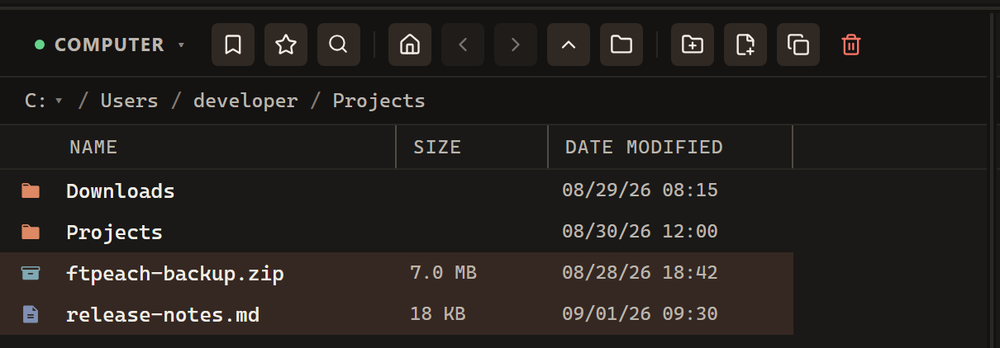
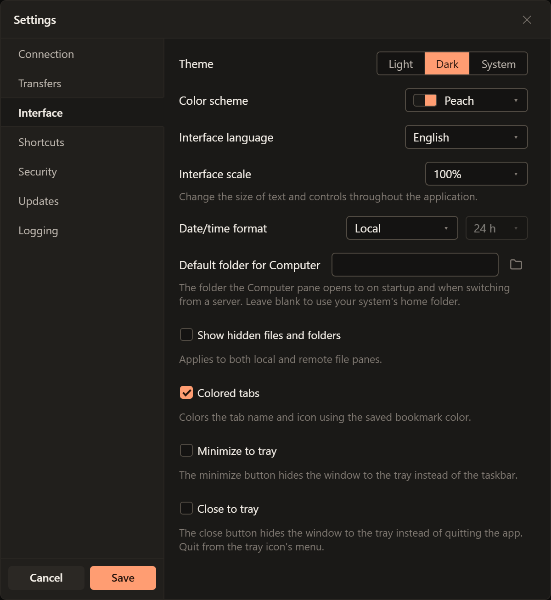

# Find your way around

Think of the window as two locations and a record of work between them. Before
copying anything, identify the source pane, the destination pane and the folder
open in each. "Other pane" in a command means the destination on the opposite
side, not a fixed upload or download folder.

<!-- verified-by: pr test/component/file-browser/paneActions.test.ts::the menus follow the order of the Explorer menu -->

## Work with tabs

Use **File > New Tab** or **Ctrl+T** to open another workspace. **Ctrl+Tab**
switches to the next tab; **Ctrl+Shift+Tab** goes to the previous one.
Use **File > Close Tab** or **Ctrl+W** to close the current tab, and **Ctrl+Shift+T**
to reopen the most recently closed tab. The last remaining tab stays open.
Check running transfers before closing a server connection.

<!-- verified-by: pr test/component/application/applicationCommands.test.tsx::tab shortcuts open, close, reopen and cycle tabs -->
<!-- verified-by: pr test/component/application/applicationCommands.test.tsx::the last tab is not closed and a single tab does not cycle -->
<!-- verified-by: pr test/unit/application/menus.test.ts::menu commands bind current tab, pane and theme and both copy refresh callbacks -->

## Open folders and find files

Read each pane from top to bottom: connection or computer, open folder, then files.

Double-click a folder to open it. **Backspace** goes up one directory level.
Click a column heading to sort the listing. The file filter helps narrow the
current list; use it after opening the folder you want to search.

<!-- verified-by: pr test/component/file-browser/paneWiring.test.tsx::a folder opens in the pane and a server file opens with its program -->
<!-- verified-by: pr test/component/file-browser/filePane.test.tsx::Backspace navigates the pane up one directory level -->
<!-- verified-by: pr test/component/file-browser/filePane.test.tsx::selects, sorts, filters and supports keyboard actions -->

Click a file to select it. **Ctrl+click** adds or removes individual files from
the selection; **Ctrl+A** selects the list. Right-click a file for the actions
available there, or right-click empty space for folder actions such as **Refresh**
and **New Folder**.

Highlighted rows are the selection. Check it before copying or deleting files.

<!-- verified-by: pr test/component/file-browser/filePane.test.tsx::Ctrl+click toggles against the current selection, not the one from before the last re-render -->
<!-- verified-by: pr test/component/file-browser/filePane.test.tsx::Ctrl+A selects every file even while a descendant control (not .pane itself) has focus -->
<!-- verified-by: pr test/component/file-browser/paneActions.test.ts::the menus follow the order of the Explorer menu -->

## Follow work in Transfers

The **Transfers** list identifies the file, route and status of a job. Check the
route when several servers are open. Running and paused jobs appear before
completed ones, and a job keeps naming its server even after that connection
closes. See [Transfers and files](transfers.md) for pausing and recovery.

<!-- verified-by: pr test/component/transfers/transferQueue.test.tsx::direction arrow is pinned before Route and File, while Status stays sortable -->
<!-- verified-by: pr test/component/transfers/transferQueue.test.tsx::queue order puts running and paused rows first, newest within each status, and completed rows last -->
<!-- verified-by: pr test/component/transfers/transferQueue.test.tsx::a transfer keeps naming its server after that connection closes -->

## Useful default shortcuts

Use these with the file pane focused. If you have changed your keyboard
shortcuts, your own bindings apply.

| Key | Action |
| --- | --- |
| Backspace | Go up one folder |
| F2 | Rename the selected entry |
| F7 | Create a folder |
| Shift+F7 | Create a file |
| F8 | Copy the selection to the other pane |
| Ctrl+C, then Ctrl+V | Copy, then paste into the destination |

<!-- verified-by: pr test/component/file-browser/filePane.test.tsx::Backspace navigates the pane up one directory level -->
<!-- verified-by: pr test/component/file-browser/filePane.test.tsx::selects, sorts, filters and supports keyboard actions -->
<!-- verified-by: pr test/component/file-browser/filePane.test.tsx::F7/Shift+F7 create a new folder/file and F8 copies the selection to the other pane -->
<!-- verified-by: pr test/component/file-browser/filePane.test.tsx::Ctrl+C/Ctrl+X mark the selection for the clipboard and Ctrl+V pastes it -->
<!-- verified-by: pr test/component/file-browser/filePane.test.tsx::a keyboardShortcuts override remaps rename to its new binding and disables the old default -->

## Appearance

Open **Edit > Settings > Interface** to find the appearance controls shown here.

Choose **Theme** (light, dark or system) and **Color scheme** separately. Changes
preview immediately; **Save** keeps them and **Cancel** restores the previous
appearance. Use **Interface language** to choose your language and **Interface
scale** to make text and controls larger or smaller, then select **Save**.

<!-- verified-by: pr test/component/settings/settingsDialog.test.tsx::previews and saves a palette independently of the theme -->
<!-- verified-by: pr test/component/settings/settingsDialog.test.tsx::Cancel restores the palette before preview -->
<!-- verified-by: pr test/component/settings/settingsDialog.test.tsx::Interface saves a chosen language and text scale -->

Transfer states keep the same meaning across color schemes: orange for active transfers,
yellow for paused, green for completed, red for failed and grey for cancelling, queued
or stopped. Connection indicators and the status bar use the same colors.

<!-- verified-by: pr test/visual/transfer-status-colors.spec.ts::transfer status colors stay readable across palettes -->
<!-- verified-by: pr test/visual/transfer-status-colors.spec.ts::connection indicators and auxiliary progress share semantic colors across palettes -->

## Selecting files

You can also drag a selection rectangle inside the file list. It stays within
that pane when the pointer crosses into the neighbouring pane.

<!-- verified-by: manual Selection rectangle with system animations disabled -->

When a folder's list is refreshed, with F5 or because a transfer finished
there, the files still in it stay selected, and the arrow keys and Shift carry
on from the same file. Files you select while the list is still loading are the
ones that stay selected.

<!-- verified-by: pr test/component/file-browser/paneRefresh.test.tsx::a transfer refresh leaves a pane the user browsed away from, and keeps the selection -->
<!-- verified-by: pr test/component/file-browser/paneRefresh.test.tsx::a selection made while the folder is listed again is the one kept -->
<!-- verified-by: pr test/component/file-browser/filePane.test.tsx::the folder listed again keeps the keyboard cursor; another folder starts from the top -->

## Everyday settings

Open **Edit > Settings**, select the category, make your changes and choose
**Save**. Use **Cancel** to discard changes.

| Task | Where to go |
| --- | --- |
| Limit transfer speed | **Transfers > Speed limit, KB/s**. Enter a limit; 0 or blank means no limit. |
| Limit simultaneous transfers | **Transfers > Concurrent transfers**. Enter a count; 0 or blank means no limit. |
| Decide what happens to matching filenames | **Transfers > On name conflict**. Choose **Ask**, **Overwrite** or **Skip**. Start with Ask if you want to review replacements. |
| Change a keyboard shortcut | **Shortcuts**. Click its current key combination and press the new one. Review any conflict warning; **Reset to default** restores one binding. |
| Connect through a proxy | **Connection > Use a proxy for connections**. Enter the type, host, port and credentials supplied by your administrator. Save and reconnect. |

<!-- verified-by: pr test/component/settings/settingsDialog.test.tsx::Transfers saves speed, concurrency and conflict handling and Updates checks on request -->
<!-- verified-by: pr test/component/settings/shortcutsSettings.test.tsx::reset buttons reflect actual differences, including recording the default again -->
<!-- verified-by: pr test/component/settings/shortcutsSettings.test.tsx::a conflict icon names the other action with its pane side and goes to it -->
<!-- verified-by: pr test/component/settings/settingsDialog.test.tsx::a change to one proxy setting saves the proxy settings together -->
<!-- verified-by: pr test/component/application/paneAndSettingsState.test.tsx::previews settings locally and persists only on explicit save -->

For proxy troubleshooting, **Test proxy** checks the proxy against the host and
port in **Test against**. Read the result before reconnecting.

<!-- verified-by: pr test/component/settings/settingsDialog.test.tsx::a proxy test error fades once a tested field changes -->

## Check for updates

Use **Help > Check for Updates** or **Edit > Settings > Updates > Check Now**.
The **Update automatically** setting controls automatic updates. Finish your
work before selecting **Install update** in the status bar.
If checking fails, keep using the current version and try again when the network
is available.

<!-- verified-by: pr test/unit/application/menus.test.ts::menu commands bind current tab, pane and theme and both copy refresh callbacks -->
<!-- verified-by: pr test/component/settings/settingsDialog.test.tsx::Transfers saves speed, concurrency and conflict handling and Updates checks on request -->
<!-- verified-by: pr test/component/application/statusBar.test.tsx::update actions download an available version and install only a downloaded version -->
