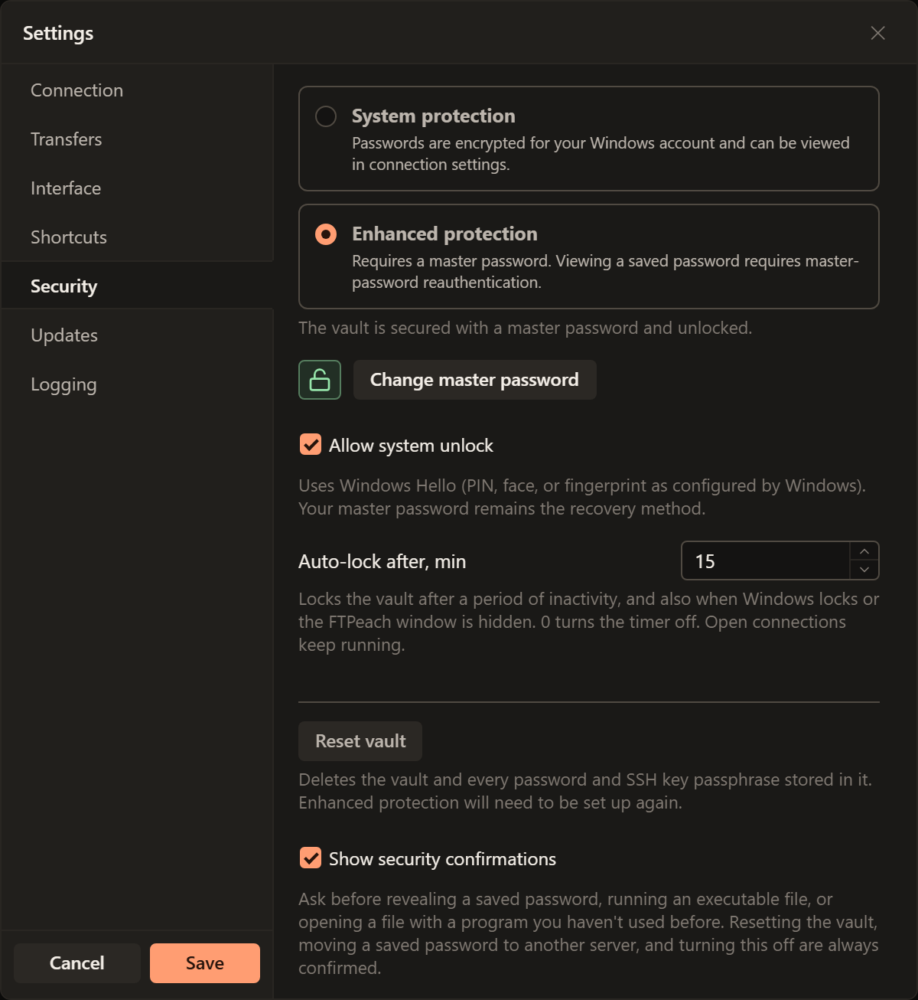
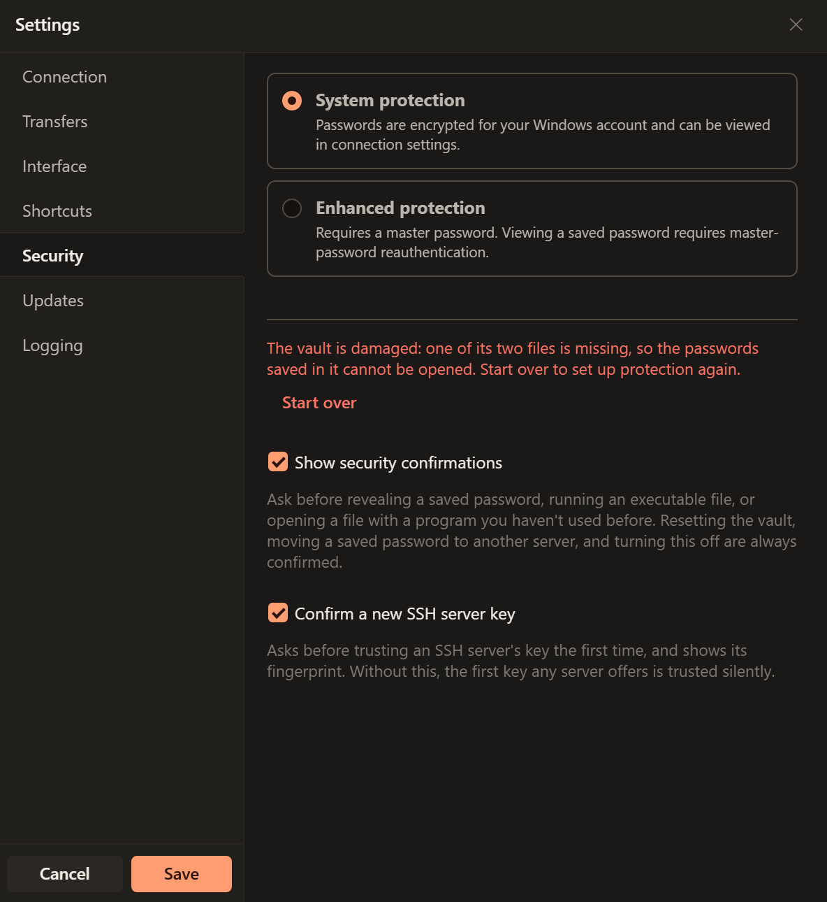
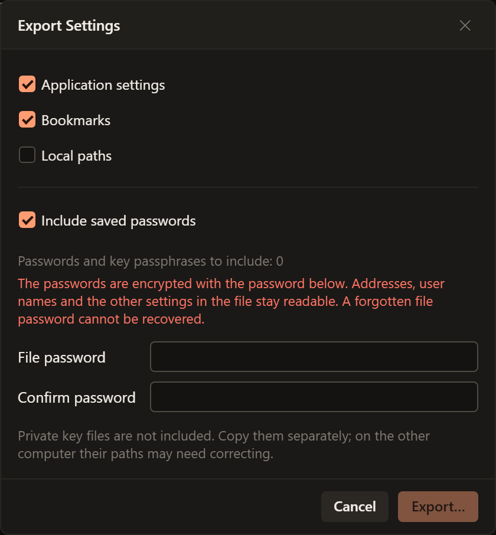

# Protect passwords and move settings

A bookmark remembers how to reach a server; a saved password lets FTPeach sign
in without asking you to type that server password again. Start with
[saving a connection](connecting.md#save-a-connection-you-will-use-again) if you
have not created a bookmark yet.

<!-- verified-by: pr test/component/sites/siteManager.test.tsx::creates and edits a bookmark through the form -->
<!-- verified-by: pr test/unit/file-browser/paneSessionLifecycle.test.ts::the connect retried after trusting a key keeps the bookmark and its saved password -->

## Know which password is being requested

| Password | What it is for |
| --- | --- |
| Server account password | Signing in to the server with your username. Your provider manages this account. |
| SSH key passphrase | Unlocking the private key you chose for SFTP. It is not the server account password. |
| FTPeach master password | Unlocking the vault of saved secrets when you have set up master-password protection. |
| Export file password | Opening saved passwords included in an exported file. You choose it when exporting. |

<!-- verified-by: pr test/component/file-browser/connectionBar.test.tsx::key authentication clears the password and warns for a selected RSA key -->
<!-- verified-by: pr src-tauri/src/security/vault_tests.rs::setup_lock_unlock_and_password_change_preserve_secrets -->
<!-- verified-by: pr test/component/settings/settingsTransfer.test.tsx::an export with the saved passwords needs a long password typed twice -->

**Edit > Settings > Security** contains password protection and unlock settings.

## Set up a master password

Open **Edit > Settings > Security**. **System protection** encrypts saved secrets
for your Windows account. **Enhanced protection** uses a master password to
unlock them, including when you carry a [portable copy](portable.md) to another
computer.

1. Select **Enhanced protection**.
2. Enter at least 12 characters in **Master password**, then repeat it in
   **Confirm master password**. Keep a safe record outside FTPeach.
3. Select **Protect saved passwords**. Wait for the status to say the vault is
   secured and unlocked.

> [!WARNING]
> **A forgotten master password cannot be recovered.** Resetting the vault deletes
> its saved passwords and SSH key passphrases; it does not recover them.

<!-- verified-by: pr test/component/settings/settingsDialog.test.tsx::Security walks from first setup through locking and changing the master password -->
<!-- verified-by: pr src-tauri/src/security/vault_tests.rs::setup_lock_unlock_and_password_change_preserve_secrets -->
<!-- verified-by: pr test/component/settings/settingsDialog.test.tsx::a vault reset tells the owner that the saved secrets are gone -->

## Lock, unlock or change the master password

In **Settings > Security**, the open-padlock button is **Lock now**. To unlock,
enter **Master password** and select the closed-padlock **Unlock** button or press
**Enter**. If Windows Hello is enabled, you can use the fingerprint button instead.

To change the password, unlock the vault and select **Change master password**.
Enter **Current master password**, **New master password** and **Confirm master
password**, then select **Change password**. The new password must have at least
12 characters. Changing it keeps the saved secrets.

<!-- verified-by: pr test/component/settings/settingsDialog.test.tsx::Security walks from first setup through locking and changing the master password -->
<!-- verified-by: pr src-tauri/src/security/vault_tests.rs::setup_lock_unlock_and_password_change_preserve_secrets -->

## After updating from FTPeach 0.5

FTPeach 0.6 keeps the vault in a new file. The first time you unlock it after the
update, with the master password or Windows Hello, FTPeach moves your saved
secrets there; the password and Windows Hello stay as they were. FTPeach 0.5
cannot open the vault after that, so do not go back to it.

<!-- verified-by: pr src-tauri/src/security/vault_tests.rs::a_vault_of_0_5_moves_to_the_new_file_on_its_first_unlock -->
<!-- verified-by: pr src-tauri/src/security/vault_tests.rs::windows_hello_alone_moves_a_vault_of_0_5 -->

## If you forget the master password

If **Allow system unlock** was already enabled on this computer, try Windows
Hello. If Hello is unavailable or refused, FTPeach asks for the master password.

<!-- verified-by: pr test/component/settings/vaultSettings.test.tsx::a refused Windows Hello asks for the password, ready to type -->

Before starting over, make sure you can get your server credentials again
from their providers, or have a usable password-protected export. When you are
ready to discard the stored secrets, use **Settings > Security > Reset vault**.
Read the confirmation, type `RESET` and choose **Delete vault**. Set up protection
again and re-enter or import the credentials you still need.

<!-- verified-by: pr src-tauri/src/security/sensitive_tests.rs::vault_reset_requires_typed_confirmation -->
<!-- verified-by: pr test/component/settings/settingsDialog.test.tsx::a vault reset tells the owner that the saved secrets are gone -->

## If FTPeach says the vault is damaged

The vault keeps saved passwords in two files. If one of them goes missing, for
example when a backup brought back only part of the FTPeach folder or a cleanup
program removed a file, the passwords saved in the vault cannot be opened.
**Settings > Security** then says the vault is damaged and offers **Start over**
instead of the usual controls.

1. Select **Start over** and confirm. The remaining vault file is set aside
   with `.damaged` added to its name, not deleted, in case the missing file
   turns up in a backup.
2. Set up protection again, as in [Set up a master password](#set-up-a-master-password).
3. Enter the passwords of your bookmarks again, or import them from a
   password-protected export.

<!-- verified-by: pr test/component/settings/settingsDialog.test.tsx::a damaged vault offers only to start over, through the reset -->
<!-- verified-by: pr src-tauri/src/security/vault_tests.rs::a_damaged_vault_is_set_aside_and_a_new_one_can_be_made -->

## Moving bookmarks and passwords to another computer

1. On the old computer, open **File > Export Settings** or **Export** in
   **Manage Bookmarks**.
2. Select **Bookmarks**. To carry their saved passwords and SSH key passphrases,
   select **Include saved passwords** and enter a file password of at least
   12 characters twice. Leave this off if you will enter server passwords again.
3. Select **Export**, complete the security confirmation and save the file.
4. On the new computer, use **File > Import Settings**, choose the file and
   enter its file password. **Import without passwords** imports bookmarks alone.

> [!WARNING]
> **Only saved passwords are encrypted in the export.** Addresses, usernames and
> other settings remain readable. Keep the file and its password separately;
> a forgotten file password cannot be recovered. The proxy password and private
> SSH key files are not included: move key files separately and check their paths.

<!-- verified-by: pr test/component/settings/settingsTransfer.test.tsx::an export with the saved passwords needs a long password typed twice -->
<!-- verified-by: pr test/unit/application/menus.test.ts::menu commands bind current tab, pane and theme and both copy refresh callbacks -->
<!-- verified-by: pr test/component/settings/settingsTransfer.test.tsx::a file with passwords can be imported without them, or let go -->
<!-- verified-by: pr src-tauri/src/security/export_secrets.rs::sealed_secrets_open_with_the_password_only -->
<!-- verified-by: pr src-tauri/src/commands/app_settings_transfer_tests.rs::export_strips_plaintext_encrypted_and_legacy_secret_fields -->

Exporting passwords asks for confirmation in a separate window. With enhanced
protection, confirm with the master password even if the vault is already open.
If Windows Hello is enabled, it is offered first; cancelling it shows the password
field. If the password is incorrect, the dialog shows an error. Try again.
If this computer cannot read some saved passwords, the dialog names the bookmarks
and asks before exporting without those passwords.

<!-- verified-by: pr src-tauri/src/security/sensitive_tests.rs::an_export_names_whether_it_carries_the_saved_passwords -->
<!-- verified-by: pr test/component/platform/securityConfirmation.test.tsx::with Windows Hello on, Hello is asked alone and the password is the fallback -->
<!-- verified-by: pr test/component/platform/securityConfirmation.test.tsx::failed reauthentication clears the password and allows a corrected retry -->
<!-- verified-by: pr test/component/settings/settingsTransfer.test.tsx::bookmarks whose passwords cannot be opened are named, and left out only when asked -->

Importing such a file asks for its password. A wrong one is asked for again;
"Import without passwords" brings in the bookmarks alone. Passwords move
between system protection and a master password in either direction.

<!-- verified-by: pr test/component/settings/settingsTransfer.test.tsx::a file with passwords asks for its password and keeps asking until it opens them -->
<!-- verified-by: pr test/component/settings/settingsTransfer.test.tsx::a file with passwords can be imported without them, or let go -->
<!-- verified-by: pr src-tauri/src/store/sites/transfer_tests.rs::passwords_carry_between_every_kind_of_protection -->

Import warnings name bookmarks whose saved passwords could not be matched safely.
Check those connections and enter their credentials again if needed.

<!-- verified-by: pr src-tauri/src/store/sites/transfer_tests.rs::a_bookmark_sent_elsewhere_than_its_secret_leaves_the_secret_behind -->

Existing saved passwords are not replaced. Importing the file again with its
password can fill in passwords omitted by an earlier import. Duplicate bookmarks
that cannot be matched unambiguously are named in the result.

<!-- verified-by: pr src-tauri/src/store/sites/transfer_tests.rs::a_second_import_fills_what_the_first_left_out_and_overwrites_nothing -->
<!-- verified-by: pr src-tauri/src/store/sites/transfer_tests.rs::a_duplicate_gets_its_secret_only_from_one_exact_recipient -->

If import fails, read the result before trying again: it says if anything could
not be undone.

<!-- verified-by: pr src-tauri/src/store/sites/transfer_tests.rs::a_bookmark_file_that_cannot_be_written_takes_the_vault_secrets_back -->
<!-- verified-by: pr src-tauri/src/commands/app_settings_transfer_tests.rs::settings_that_cannot_be_saved_undo_the_bookmarks_and_their_passwords -->
<!-- verified-by: pr src-tauri/src/store/sites/transfer_tests.rs::an_undone_import_names_what_it_could_not_undo_and_restores_the_rest -->

A file exported without passwords imports as before. FTPeach 0.4.0 and older
refuse a file with passwords, as they refuse any file with fields they do not
know.

<!-- verified-by: pr src-tauri/src/commands/app_settings_transfer_tests.rs::a_file_with_repeated_ids_or_a_future_format_is_refused -->
<!-- verified-by: pr src-tauri/src/commands/app_settings_transfer_tests.rs::an_empty_or_foreign_file_is_named_as_not_a_settings_file -->

## Unlocking with Windows Hello

Unlock the vault in **Settings > Security**, turn on **Allow system unlock** and
complete the Windows Hello prompt. Keep the master password as your recovery method.

<!-- verified-by: pr test/component/settings/vaultSettings.test.tsx::protection changes refresh status and cancelled resets preserve the setup form -->

Windows Hello unlock is enabled separately on each computer. When the vault
is moved or carried to another computer, it opens there with the master
password, and Windows Hello can be switched on there as well. Switching it off
on one computer leaves it on for the others.

<!-- verified-by: pr src-tauri/src/security/vault_tests.rs::windows_hello_is_switched_on_and_off_per_computer -->

If Windows loses the key, as after a reset of the computer's security chip, the
switch shows off and can be turned on again.

<!-- verified-by: pr src-tauri/src/security/vault_tests.rs::hello_stands_in_for_the_password_and_a_lost_key_does_not_jam_the_switch -->
