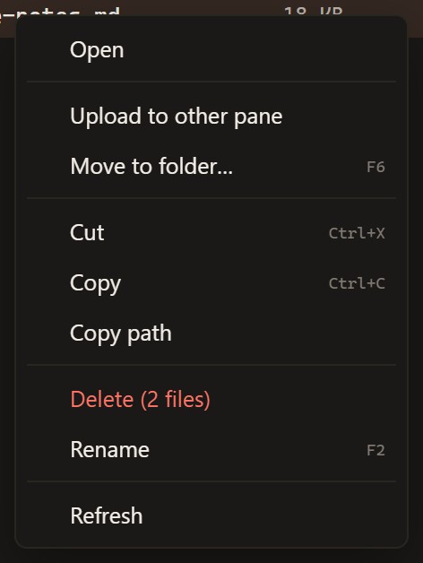
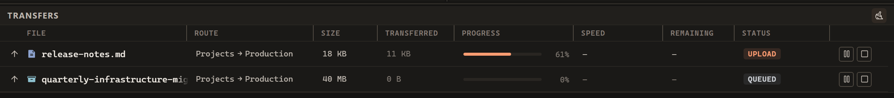

# Transfers and files

Use a copy when you want the file in another location while keeping the source.
First open the destination folder in the other pane, then select the files or
folders you want to send.

## Upload, download or copy

| From → to | Action in the source pane's right-click menu |
| --- | --- |
| Computer → server | Upload to other pane |
| Server → computer | Download to other pane |
| Server → another server | Copy to other pane |

Right-click the source selection. **Upload to other pane** sends it to the server
folder open on the other side.

<!-- verified-by: pr test/component/file-browser/paneActions.test.ts::the menus follow the order of the Explorer menu -->
<!-- verified-by: pr test/component/file-browser/paneActions.test.ts::remote-to-remote copies are labelled correctly and unavailable transfers are disabled -->

1. Check the server or computer and the open path in both panes.
2. Select the files or folders in the source pane. Choose the action above, or
   press **F8** with that pane focused using the default shortcuts.
3. If asked about existing files, decide whether those destination copies should
   be replaced. A matching name does not mean that the contents are the same.
4. Follow the job in **Transfers** and check its final result before closing the
   connection or removing the source.

<!-- verified-by: pr test/component/file-browser/paneActions.test.ts::a folder, and a whole selection, can be sent to the other pane from the menu -->
<!-- verified-by: pr test/component/file-browser/filePane.test.tsx::F7/Shift+F7 create a new folder/file and F8 copies the selection to the other pane -->
<!-- verified-by: pr test/component/transfers/useTransfers.test.tsx::file batch consent does not authorize replacing files inside a sibling folder -->
<!-- verified-by: pr test/component/transfers/transferQueue.test.tsx::direction arrow is pinned before Route and File, while Status stays sortable -->

For a server-to-server copy, connect both panes and open the source folder on
one and the destination folder on the other. Files and folders can be sent this
way. For a first upload or download, follow [Your first transfer](getting-started.md).

<!-- verified-by: pr test/component/transfers/useTransfers.test.tsx::folder upload, download and relay submit endpoint intent without per-file IPC -->

Before sending files with names already at the destination, check
**Edit > Settings > Transfers > On name conflict**:
**Ask** requests your decision, **Overwrite** allows replacement without that
question, and **Skip** leaves matching files alone. Start with **Ask** if you
want to review replacements. See [Everyday settings](interface.md#everyday-settings) to change the policy.

<!-- verified-by: pr test/component/settings/settingsDialog.test.tsx::Transfers saves speed, concurrency and conflict handling and Updates checks on request -->
<!-- verified-by: pr test/component/transfers/useTransfers.test.tsx::Ask confirms an existing file while Overwrite and Skip do not ask -->

## Pausing, stopping and resuming transfers

Example jobs with some columns hidden. **Pause** (two bars) and **Stop** (a square)
are at the right of an active row.

**Pause** keeps what has arrived so far, and **Resume** carries the job on later in
this session. **Stop** cancels the job; **Retry** on a stopped job starts it over.

<!-- verified-by: pr test/component/transfers/useTransfers.test.tsx::retryTransfer resumes paused uploads and downloads, but restarts stopped ones -->

If a transfer reports an error, read it before retrying: wrong permissions,
insufficient space or a changed source need attention first. See
[Troubleshooting](troubleshooting.md#my-transfer-did-not-finish).

A paused FTP, FTPS or SFTP upload resumes when FTPeach confirms that neither the source nor the part already
on the server has changed; otherwise it starts again. WebDAV uploads, including folder uploads, do not
offer Pause because they cannot continue a partly uploaded file.

<!-- verified-by: pr test/component/transfers/useTransfers.test.tsx::retryTransfer resumes paused uploads and downloads, but restarts stopped ones -->
<!-- verified-by: pr src-tauri/src/application/upload_resume_tests.rs::staged_prefix_of_an_unchanged_source_resumes_at_its_length -->
<!-- verified-by: pr src-tauri/src/application/upload_resume_tests.rs::a_source_edited_while_paused_restarts_and_drops_its_staging -->
<!-- verified-by: pr src-tauri/src/application/upload_resume_tests.rs::staging_that_is_not_a_prefix_restarts_even_when_the_pin_matches -->
<!-- verified-by: pr test/unit/transfers/transferStore.test.ts::a folder walk pauses only where the file it cuts short can carry on -->
<!-- verified-by: pr test/component/transfers/useTransfers.test.tsx::pauseAllTransfers only pauses uploads that can prove a resume, but stopAllTransfers reaches everything active -->
<!-- verified-by: pr test/component/transfers/useTransfers.test.tsx::an upload asks to resume only after a pause, never after a stop -->

Resuming a paused transfer does not ask again whether to replace the file
there: it keeps the answer given when the transfer started.

<!-- verified-by: pr test/component/transfers/useTransfers.test.tsx::resuming a paused transfer reuses its overwrite answer instead of asking again -->

When the connection to a server is lost, the transfers it cut off can be retried once the
pane is connected again to the same server with the same account. Until then their Retry button
is unavailable.

<!-- verified-by: pr test/component/file-browser/transferConnectionLoss.test.tsx::Retry of a transfer on a lost connection waits until the pane connects again -->
<!-- verified-by: pr test/unit/transfers/transferStore.test.ts::a new connection to the same account takes over the finished rows a closed one left -->

### Before a full exit or restart

If FTPeach is still in the system tray, reopen it and check **Transfers**
before starting another copy of the same job. The instructions below concern
a full application exit, not just a hidden window.

Finish important transfers before exiting FTPeach or restarting Windows.
The transfer queue does not return in a fresh application process. A paused
upload is not a saved job for the next launch: keep its server connection open
if you want to resume it. After exiting, select the source again and start
a new upload. A download can carry on after an exit; see
[Interrupted downloads](#interrupted-downloads).

<!-- verified-by: pr test/unit/transfers/transferStore.test.ts::a fresh process starts without the previous transfer queue -->
<!-- verified-by: pr test/component/application/quitWhenIdle.test.tsx::paused and failed transfers do not hold the quit up -->
<!-- verified-by: pr src-tauri/src/application/upload_resume_tests.rs::tearing_down_a_connection_deletes_every_staging_it_held -->
<!-- verified-by: pr test/component/transfers/useTransfers.test.tsx::an upload asks to resume only after a pause, never after a stop -->

### When an upload is interrupted

Stopping an upload never deletes a file that was already on the server under
the same name. The old file stays in place until the new one has fully
arrived.

<!-- verified-by: pr src-tauri/src/application/transfer_service_tests.rs::queued_and_active_upload_cancellation_preserve_old_target_and_cleanup_only_staging -->
<!-- verified-by: pr test/component/transfers/useTransfers.test.tsx::stopping queued and active uploads never requests deletion of the destination -->

If another program saves over a file while it uploads, the upload ends with an
error saying the file changed, and the file already on the server stays as it
was; upload it again to send the new version.

<!-- verified-by: pr src-tauri/src/application/transfer_service_tests.rs::a_source_saved_over_while_uploading_is_not_put_in_place_and_says_so -->

Stopping a folder upload keeps the files that already reached the server.
Cleanup targets only its own temporary upload file; a server that refuses
cleanup or cannot be reached can leave that temporary file behind.

<!-- verified-by: pr src-tauri/src/protocol/ftp_tests.rs::a_stopped_folder_upload_settles_at_once_and_keeps_what_landed -->
<!-- verified-by: pr src-tauri/src/protocol/ftp_tests.rs::staging_the_server_will_not_delete_does_not_turn_a_stop_into_a_failure -->
<!-- verified-by: pr src-tauri/src/application/recursive_transfer/tests.rs::stopping_a_paused_upload_keeps_what_landed_and_removes_only_its_own_staging -->

## Interrupted downloads

To finish an interrupted download, even after exiting FTPeach, reconnect, select
the same server file and download it to the same local folder and filename. It
carries on from where it stopped only when the server, account, path, size and
version still match. A changed or unavailable size or version starts a new
download. This compares the server's metadata, not the complete file
contents: a same-size change with the same reported version can go unnoticed.
See [resume limits](protocol-reference.md#limitations).

<!-- verified-by: pr test/component/transfers/useTransfers.test.tsx::a real (non-user-initiated) transfer failure reports the error and marks the row -->
<!-- verified-by: pr src-tauri/src/protocol/transfer_file_tests.rs::a_download_lifecycle_writes_resumes_and_commits_once -->
<!-- verified-by: pr src-tauri/src/protocol/transfer_file_tests.rs::resume_requires_the_same_endpoint_path_size_and_version -->
<!-- verified-by: pr src-tauri/src/protocol/transfer_file_tests.rs::an_unknown_size_or_changed_source_starts_over_and_is_never_treated_as_zero -->

If a download does not finish, a file you already had under that name is kept
unchanged.

<!-- verified-by: pr src-tauri/src/protocol/transfer_file_tests.rs::a_short_download_or_a_refused_commit_keeps_the_old_file -->

Before a downloaded file takes its name, FTPeach asks the server again for its
size and version. If they changed while the file was downloading, it reports
that, keeps the file you had and starts the next try from the beginning. When
the server gives no version, only the size is compared, and a change of the
same size can go unnoticed. If the server does not answer the second time,
the downloaded file is kept and the log says the check could not be made.

<!-- verified-by: pr src-tauri/src/protocol/ftp_tests.rs::a_file_saved_on_the_server_during_the_download_is_not_put_in_place -->
<!-- verified-by: pr src-tauri/src/protocol/sftp_tests.rs::a_file_saved_on_the_server_during_the_download_is_not_put_in_place -->
<!-- verified-by: pr src-tauri/src/protocol/webdav_tests.rs::a_file_saved_on_the_server_during_the_download_is_not_put_in_place -->
<!-- verified-by: pr src-tauri/src/protocol/transfer_file_tests.rs::a_read_is_kept_only_while_the_server_still_describes_the_same_file -->

A download that fails before receiving anything, such as one of a file deleted
on the server, leaves nothing beside the destination.

<!-- verified-by: pr src-tauri/src/protocol/transfer_file_tests.rs::a_download_that_gets_nothing_leaves_nothing_behind -->

## Downloaded files

On NTFS, FTPeach writes a Windows origin mark to downloaded files. It identifies
local-network servers as intranet and other servers as internet. The mark
records the server address without your user name or password and stays with
the file when it is renamed. A drive formatted as FAT32 or exFAT, as many USB
sticks are, cannot keep this mark. See [download security limits](../security.md#rust-and-remote-servers).

<!-- verified-by: pr src-tauri/src/local_fs/provenance.rs::a_host_that_cannot_be_reached_from_outside_is_the_intranet -->
<!-- verified-by: pr src-tauri/src/local_fs/provenance.rs::anything_else_is_the_internet -->
<!-- verified-by: pr src-tauri/src/local_fs/provenance.rs::the_mark_carries_the_address_but_never_an_account -->
<!-- verified-by: pr src-tauri/src/local_fs/provenance.rs::the_mark_lands_beside_the_file_and_survives_being_renamed -->

## Copying files and folders

To copy within your computer, keep both panes on **Computer**, open the source
and destination folders, select the entries and press **F8**. You can also use
**Ctrl+C**, open the destination and press **Ctrl+V**. To create a destination
folder first, right-click empty space and choose **New Folder**, or press **F7**.

<!-- verified-by: pr test/component/file-browser/filePane.test.tsx::F7/Shift+F7 create a new folder/file and F8 copies the selection to the other pane -->
<!-- verified-by: pr test/component/file-browser/filePane.test.tsx::Ctrl+C/Ctrl+X mark the selection for the clipboard and Ctrl+V pastes it -->

Local file copies appear in Transfers while running and keep their final result.
A failed copy can be retried from its row.

<!-- verified-by: pr test/component/transfers/useTransfers.test.tsx::local copies appear in Transfers while running and keep their final result -->

With overwrite handling set to Ask, merging into an existing folder asks separately
for permission to replace matching files inside it. Approving other files in the
same selection does not approve the folder's contents.

<!-- verified-by: pr test/component/transfers/useTransfers.test.tsx::file batch consent does not authorize replacing files inside a sibling folder -->

A file cannot replace a folder, or a folder a file. The message identifies the
skipped names; other selected files can still be copied.

<!-- verified-by: pr test/component/transfers/useTransfers.test.tsx::batch rejects file-folder mismatches and still copies the other names -->

## Renaming and moving

To rename, select one entry, press **F2**, type the new name and press **Enter**.
To move, right-click the selection and choose **Move to folder…**, then choose
the destination folder. Alternatively, press **Ctrl+X**, open the destination
on the same computer or server connection and press **Ctrl+V**.

<!-- verified-by: pr test/component/file-browser/filePane.test.tsx::selects, sorts, filters and supports keyboard actions -->
<!-- verified-by: pr test/component/file-browser/paneActions.test.ts::move destinations preserve display order and exclude selected folders -->
<!-- verified-by: pr test/component/file-browser/filePane.test.tsx::Ctrl+C/Ctrl+X mark the selection for the clipboard and Ctrl+V pastes it -->

When renaming or moving finds another file with the same name, FTPeach asks
before replacing it. If several people are editing the same server folder,
coordinate changes: FTP cannot guarantee that a new file created by another
client during the rename will be preserved. See the
[file operation guarantees](../transfer-safety.md#guarantee-matrix) for details.

<!-- verified-by: pr test/unit/file-browser/paneFileOperations.test.ts::rename replaces a target only on an explicit decision -->
<!-- verified-by: pr test/component/transfers/useTransfers.test.tsx::Move to replaces a target only after explicit approval -->
<!-- verified-by: pr src-tauri/src/protocol/ftp_tests.rs::no_replace_rename_refuses_a_taken_target_and_moves_onto_a_free_one -->

When a cut selection includes files you skip, it stays available to paste after
the other files move.

<!-- verified-by: pr test/component/transfers/useTransfers.test.tsx::a cut with skipped conflicts stays on the clipboard after the other files move -->

Files can be moved only on your computer or within one server connection.
Between your computer and a server, or between two servers, FTPeach refuses the
move and changes nothing. Copy the files instead.

<!-- verified-by: pr test/component/transfers/useTransfers.test.tsx::a move between different endpoints touches nothing, for files and folders -->

## Delete files and folders

Select the entries, right-click and choose **Delete**. Read the confirmation
and check the location and selection before approving it. Local files normally
go to the Recycle Bin. If that location has no Recycle Bin, FTPeach asks again
before permanently deleting them; cancelling keeps the files.

> [!WARNING]
> **Deleting from a server is permanent in FTPeach:** remote files do not go to your
> computer's Recycle Bin. Download a backup first if you may need them again.

<!-- verified-by: pr test/component/file-browser/paneActions.test.ts::Shift on this computer turns Delete into Delete permanently; a server has no bin to skip -->
<!-- verified-by: pr test/unit/file-browser/paneFileOperations.test.ts::what has no Recycle Bin is offered for a permanent delete, the rest goes to the bin -->
