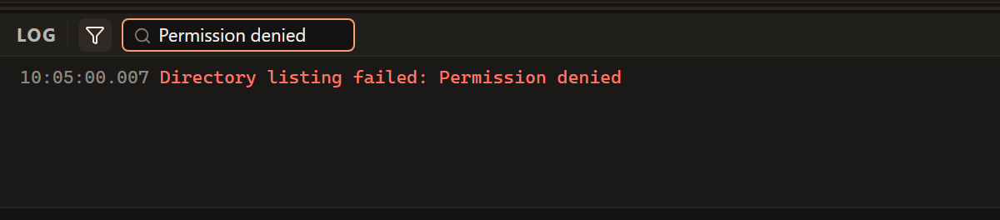

# Troubleshooting

Start with the operation that failed and the exact error message. Check the
server, account and folder involved before trying again. The same symptom can
have several causes; the checks below help narrow them down.

## I cannot connect

Compare the connection form with the details from your provider. Check the
protocol as well as the address and port. If the server requires a VPN or access
from an approved network, connect from that network first.

| Message or symptom | What to check next |
| --- | --- |
| Server not found | Recheck the hostname for typing errors and confirm it with the provider. |
| Connection refused | Check the protocol and port. Ask whether the file transfer service is running and allows your connection. |
| Server is not responding | Check your network or VPN and the server's availability. A timeout alone does not identify which side is at fault. |
| Incorrect username or password | Check the account and authentication method. For SFTP, confirm whether the account requires a key. |
| Invalid WebDAV address | Use the full HTTP or HTTPS URL supplied by the provider, including its folder path. |

<!-- verified-by: pr test/unit/platform/errorMessages.test.ts::friendlyError localizes every structured command error code -->
<!-- verified-by: pr test/unit/file-browser/paneSessionLifecycle.test.ts::invalid WebDAV addresses stay in the pane without starting a session -->

For form instructions, see [Connect to a server](connecting.md). For key files,
passphrases and SSH errors, see [SFTP troubleshooting](sftp.md#when-sftp-does-not-connect).
For TLS errors, see [FTPS troubleshooting](ftps.md#when-ftps-does-not-connect).
For WebDAV URLs, HTTP sign-in and authentication methods, see [WebDAV troubleshooting](webdav.md#when-webdav-does-not-connect).
If FTP or FTPS signs in but does not list files, check [the data-connection mode](ftp.md#passive-and-active-mode).

## The server identity is not trusted

A certificate error or changed SSH host key is a reason to verify the server's
identity with its administrator. Ask whether the server was replaced or its
certificate or key was changed, and obtain the expected identity through a
trusted channel. Do not disable verification just to dismiss the message.

FTPeach refuses a changed SSH host key. For a first connection, follow
[Connecting safely](connecting.md#connecting-safely) before accepting the key.

<!-- verified-by: pr src-tauri/src/protocol/sftp_tests.rs::local_server_pins_reuses_and_rejects_changed_host_key -->
<!-- verified-by: pr src-tauri/src/protocol/ftp_tests.rs::local_ftps_server_rejects_bad_certificate_unless_explicitly_allowed -->

## My transfer did not finish

Find the file's row in **Transfers** and read the error. Then check the relevant
condition before retrying:

| Problem | Next action |
| --- | --- |
| Connection lost | Reconnect the pane to the same server and account, then use Retry. |
| Permission denied | Confirm the destination folder and ask the administrator whether this account may write or replace files there. |
| Not enough free space | Check free space or quota at the destination. A server administrator may need to check a remote quota. |
| Source changed during upload | Finish saving the source file, then upload it again. |
| File open in another program | Close the program holding the file and try again. |

<!-- verified-by: pr test/component/file-browser/transferConnectionLoss.test.tsx::Retry of a transfer on a lost connection waits until the pane connects again -->
<!-- verified-by: pr test/unit/platform/errorMessages.test.ts::friendlyError localizes every structured command error code -->
<!-- verified-by: pr src-tauri/src/application/transfer_service_tests.rs::a_source_saved_over_while_uploading_is_not_put_in_place_and_says_so -->

If **Pause** is unavailable for a WebDAV upload, this is expected: that upload
cannot continue a partly sent file. A stopped upload starts over when retried.
See [pause and resume behavior](transfers.md#pausing-stopping-and-resuming-transfers)
before deciding to stop a large job.

<!-- verified-by: pr test/component/transfers/useTransfers.test.tsx::pauseAllTransfers only pauses uploads that can prove a resume, but stopAllTransfers reaches everything active -->
<!-- verified-by: pr test/component/transfers/useTransfers.test.tsx::retryTransfer resumes paused uploads and downloads, but restarts stopped ones -->

## I cannot move files to the other server

Move works within your computer or one server connection. To transfer files
between your computer and a server, or between two servers, use Copy instead.
Verify the destination before deciding whether to delete the originals.

<!-- verified-by: pr test/component/transfers/useTransfers.test.tsx::a move between different endpoints touches nothing, for files and folders -->

## My edit is not on the server

Saving in the editor changes the edit copy on your computer. Check that you approved its
upload in FTPeach and that the upload succeeded. If the app closed before you
finished, inspect the recovered edits it offers on startup. Follow
[Editing remote files](editing.md) to finish the work.

<!-- verified-by: pr test/component/open-with/openWithRecovery.test.tsx::only an uploaded revision is marked synced, and a failed upload asks again -->
<!-- verified-by: pr test/component/open-with/openWithRecovery.test.tsx::recovered edits are offered at start and stay unless deleted -->

## Saved passwords do not work on a new computer

Check how the passwords were moved. A portable copy without a master password
keeps passwords tied to the original computer. For a separate installation,
use [export and import with saved passwords](passwords.md#moving-bookmarks-and-passwords-to-another-computer).
If an import was done without passwords, you will need the server credentials
or the password-protected export. Windows Hello must be enabled on the new
computer separately.

<!-- verified-by: pr test/component/settings/settingsDialog.test.tsx::a portable copy says where passwords stay until a master password is set -->
<!-- verified-by: pr test/component/settings/settingsTransfer.test.tsx::a file with passwords can be imported without them, or let go -->
<!-- verified-by: pr src-tauri/src/security/vault_tests.rs::windows_hello_is_switched_on_and_off_per_computer -->

## I cannot unlock saved passwords

Check whether the prompt wants the FTPeach master password, a server password or
an export file password. If Windows Hello fails, try the master password.
For a forgotten password, read [recovery and reset](passwords.md#if-you-forget-the-master-password)
before deleting anything: resetting the vault loses its stored secrets.

<!-- verified-by: pr test/component/settings/vaultSettings.test.tsx::a refused Windows Hello asks for the password, ready to type -->
<!-- verified-by: pr test/component/settings/settingsDialog.test.tsx::a vault reset tells the owner that the saved secrets are gone -->

## Ask for help

Open **View > Log** to show the log panel. To find your FTPeach version,
open **Help > About** and note the version beside the application name.

<!-- verified-by: pr test/unit/application/menus.test.ts::menu commands bind current tab, pane and theme and both copy refresh callbacks -->
<!-- verified-by: pr test/unit/application/menus.test.ts::View Log toggles the log panel -->
<!-- verified-by: pr test/component/shared/dialogFailures.test.tsx::About displays the installed app version -->

Use the log's search field to find the relevant message. This example filters
for "Permission denied"; it is not a diagnosis of your connection.

<!-- verified-by: pr test/component/logs/logPanel.test.tsx::search shows only the lines that contain the text, and Escape clears it -->

Use **Copy log to clipboard** or **Save log to file** in the log toolbar to
collect the relevant lines. Check the copied or saved text before sharing it;
the privacy precautions below apply to logs and screenshots too.

<!-- verified-by: pr test/component/logs/logPanel.test.tsx::Copy flashes its tooltip on the button once the clipboard write settles -->
<!-- verified-by: pr test/component/logs/logPanel.test.tsx::Save writes only the lines shown, and says so only when the write failed -->

For account details, permissions, quota or server identity, contact your server
administrator or hosting provider. If the problem appears to be in FTPeach,
[report an issue](https://github.com/Smooveemaan/ftpeach/issues/new/choose) with:

- Your FTPeach version and Windows version.
- The protocol and operation, such as uploading a folder over SFTP.
- The steps to reproduce it, the expected result and the exact error text.
- Whether it happens every time, and whether a small test file behaves the same.

Remove passwords, private keys and private server or file details from anything
you share. Never attach a vault, a settings export containing secrets, or a
private key to a public issue. Report security vulnerabilities through the
[security policy](../../.github/SECURITY.md).
