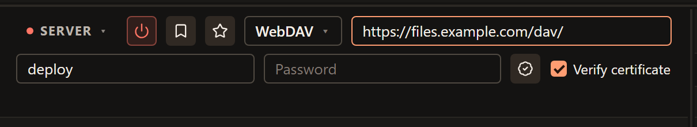
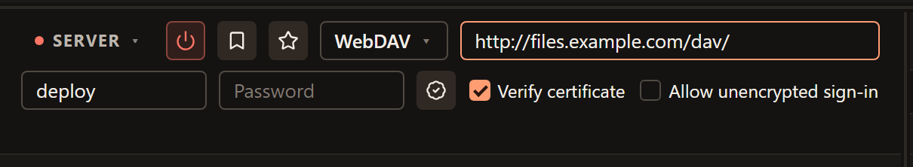

# WebDAV connections

Use WebDAV when your storage provider gives you a WebDAV address. FTPeach opens
that location as a file pane so you can browse folders, upload and download
files. A link that opens a website or its browser sign-in page is not necessarily
a WebDAV endpoint.

<!-- verified-by: pr src-tauri/src/protocol/webdav_tests.rs::local_server_round_trips_file_operations_and_resumed_download -->
<!-- verified-by: pr src-tauri/src/protocol/webdav_tests.rs::connect_rejects_a_successful_html_login_page -->

## Get the right address

Ask your provider for the full WebDAV URL, the username and the password to use
with a file client. Include the provider's folder path, not just its hostname.
If the service requires an application-specific password, obtain that from the
provider before connecting.

| Example | What to enter |
| --- | --- |
| `https://files.example.com/dav/` | A full HTTPS address, including the WebDAV folder. Replace this example with the provider's URL. |
| `https://files.example.com:8443/dav/` | Include a custom port in the URL when the provider specifies one. |
| `files.example.com` | Incomplete: add the scheme and the actual WebDAV path supplied by the provider. |

<!-- verified-by: pr test/unit/file-browser/paneSessionLifecycle.test.ts::WebDAV accepts an absolute URL with a custom port -->
<!-- verified-by: pr test/unit/file-browser/paneSessionLifecycle.test.ts::invalid WebDAV addresses stay in the pane without starting a session -->

Put credentials in **Username** and **Password**, not inside the address.
FTPeach rejects addresses containing embedded credentials, a query (`?`) or a
fragment (`#`). If the link you were given contains these, ask for the WebDAV
endpoint rather than deleting pieces of the link and guessing.

<!-- verified-by: pr src-tauri/src/protocol/webdav_tests.rs::a_webdav_address_may_not_carry_credentials_or_a_query -->

## Connect over HTTPS

1. Open the source menu at the top of a pane and choose **Server**.
2. Select **WebDAV** and paste the full URL into **Address**.
3. Enter **Username** and **Password**. Leave **Verify certificate** enabled
   for HTTPS.
4. Select **Connect**. When the folder listing appears, try a small file using
   [Your first transfer](getting-started.md).

The path belongs in the address field. Use your provider's URL and account
details in place of this example.

<!-- verified-by: pr test/component/file-browser/paneSourceSwitcher.test.tsx::the source selector opens a server form and returns to the computer -->
<!-- verified-by: pr test/unit/file-browser/paneSessionLifecycle.test.ts::WebDAV accepts an absolute URL with a custom port -->
<!-- verified-by: pr test/component/file-browser/connectionBar.test.tsx::WebDAV distinguishes HTTP authentication permission from certificate validation -->

FTPeach signs in with **HTTP Basic authentication**; HTTPS protects the
connection carrying those credentials. A server that accepts only **Digest
authentication** is unsupported and fails sign-in. Ask the administrator for a
compatible endpoint rather than repeatedly changing a working password.

<!-- verified-by: pr src-tauri/src/protocol/webdav_tests.rs::basic_login_succeeds_but_a_digest_only_server_is_refused -->

For repeat visits, [save a bookmark](connecting.md#save-a-connection-you-will-use-again).

## HTTPS certificates and plain HTTP

Keep **Verify certificate** enabled for HTTPS. If the provider uses a private
certificate authority, the **CA certificate** button lets you select its trusted
certificate file. Get the file through a trusted channel and confirm the server
hostname with the administrator. Turning verification off allows invalid
certificates; it is not a repair for an incorrectly configured server.

<!-- verified-by: pr test/component/file-browser/connectionBar.test.tsx::WebDAV distinguishes HTTP authentication permission from certificate validation -->
<!-- verified-by: pr src-tauri/src/protocol/webdav_tests.rs::an_unchecked_certificate_is_warned_about_once_and_only_over_tls -->

An `http://` address is different: the connection is unencrypted. By default,
FTPeach does not send your password to it. It can follow a suitable upgrade to
HTTPS on the same host and path, but does not treat a redirect to a different
host as permission to send credentials there.

<!-- verified-by: pr src-tauri/src/protocol/webdav_tests.rs::an_unencrypted_server_never_sees_the_password -->
<!-- verified-by: pr src-tauri/src/protocol/webdav_tests.rs::the_address_is_only_ever_upgraded_never_downgraded -->

**Allow unencrypted sign-in** appears for HTTP addresses. Leave it off and ask
for an HTTPS endpoint. Enable it only if you deliberately accept sending the
account credentials over plain HTTP. It is separate from **Verify certificate**:
changing certificate verification does not authorize an unencrypted sign-in.

<!-- verified-by: pr src-tauri/src/protocol/webdav_tests.rs::cleartext_login_is_refused_until_the_user_allows_it -->
<!-- verified-by: pr test/component/file-browser/connectionBar.test.tsx::WebDAV distinguishes HTTP authentication permission from certificate validation -->

## Transfers and permissions

WebDAV uploads do not offer **Pause**. If an upload is stopped, retrying starts
it again from the beginning. Downloads can resume only when the remote version
and the server's response make resuming safe; otherwise they restart. Read
[pause and resume behavior](transfers.md#pausing-stopping-and-resuming-transfers)
before stopping a large job.

<!-- verified-by: pr test/component/transfers/useTransfers.test.tsx::pauseAllTransfers only pauses uploads that can prove a resume, but stopAllTransfers reaches everything active -->
<!-- verified-by: pr test/component/transfers/useTransfers.test.tsx::retryTransfer resumes paused uploads and downloads, but restarts stopped ones -->
<!-- verified-by: pr src-tauri/src/protocol/webdav_tests.rs::resume_restarts_when_range_is_ignored_and_rejects_416 -->
<!-- verified-by: pr src-tauri/src/protocol/webdav_tests.rs::a_version_from_the_second_the_file_changed_is_not_trusted -->

Permission can differ between folders and operations. Being able to sign in or
list files does not mean you may upload, replace or delete them. Ask the provider
about the destination folder's permissions, quota and upload-size limits when
an operation is refused.

<!-- verified-by: pr src-tauri/src/protocol/webdav_tests.rs::a_401_is_a_rejected_login_at_connect_and_a_denied_resource_after -->

## When WebDAV does not connect

| Message or symptom | Next step |
| --- | --- |
| Enter the full WebDAV address, starting with http:// or https://. | Use the provider's complete WebDAV URL, including the scheme and folder path. |
| A WebDAV address can't contain ? or # | Obtain a WebDAV endpoint rather than a browser-sharing or sign-in link. Enter credentials in their own fields. |
| Incorrect username or password. | Confirm the WebDAV account details, any application-specific password requirement and the authentication method. Digest-only services are unsupported. |
| The server asks for a password over an unencrypted connection | Ask for HTTPS. Use Allow unencrypted sign-in only if you accept the exposure described above. |
| The server's certificate isn't valid. | Check the hostname and certificate with the provider; obtain the correct trusted CA file if needed. |
| The URL works in a browser, but FTPeach cannot list files | Confirm that it is a WebDAV endpoint, not an HTML sign-in page or shared download link. |
| You don't have permission for this operation. | Check this folder's permissions with the provider, even if signing in succeeded. |

<!-- verified-by: pr test/unit/platform/errorMessages.test.ts::friendlyError localizes every structured command error code -->
<!-- verified-by: pr src-tauri/src/protocol/webdav_tests.rs::basic_login_succeeds_but_a_digest_only_server_is_refused -->
<!-- verified-by: pr src-tauri/src/protocol/webdav_tests.rs::connect_rejects_a_successful_html_login_page -->
<!-- verified-by: pr src-tauri/src/protocol/webdav_tests.rs::a_401_is_a_rejected_login_at_connect_and_a_denied_resource_after -->

If you need help, include the exact error and operation, using the
[troubleshooting checklist](troubleshooting.md#ask-for-help). Remove passwords,
tokens and private URL details before sharing anything.
